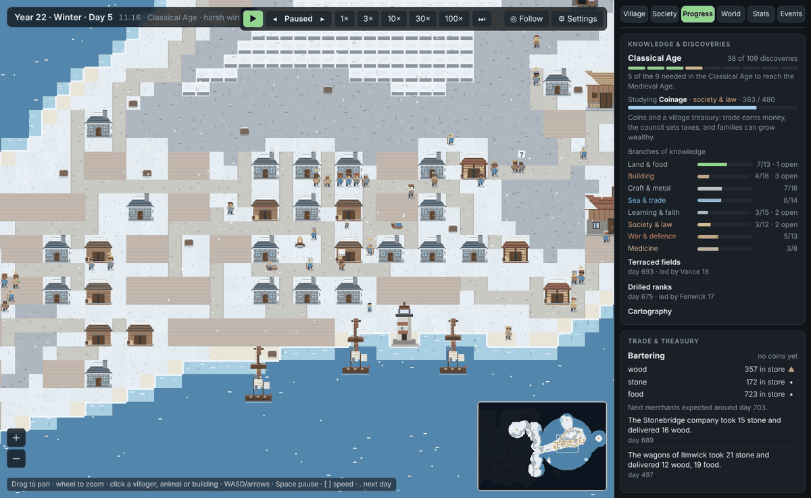
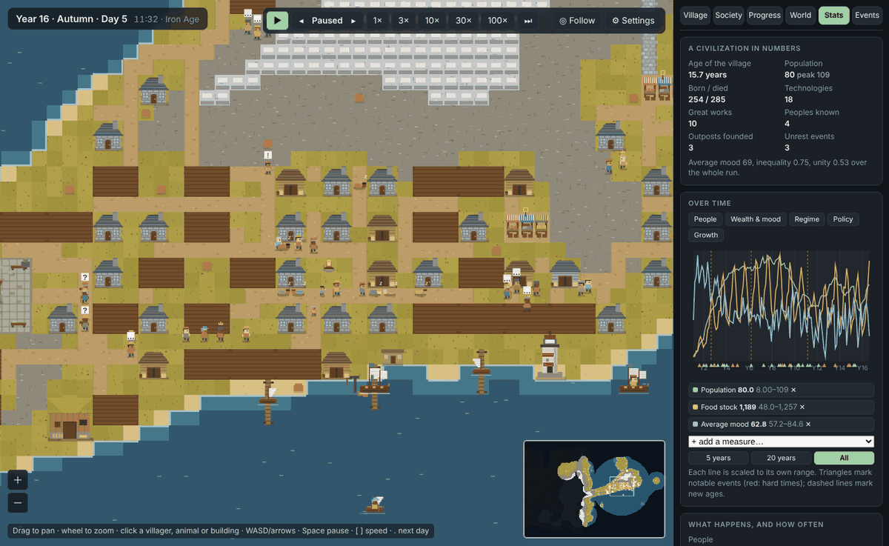
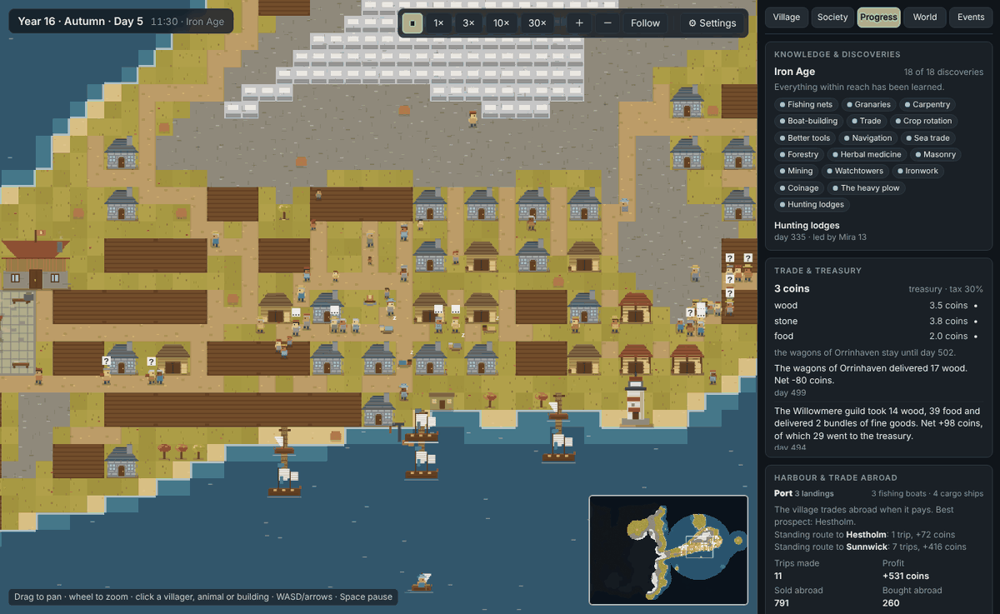
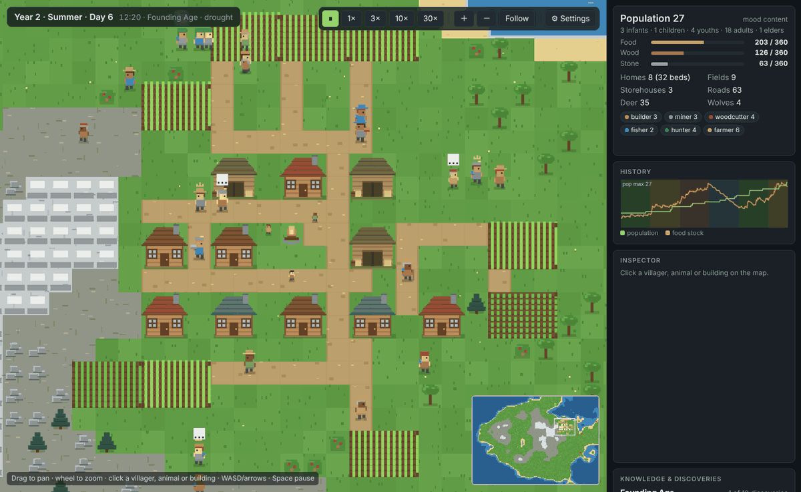
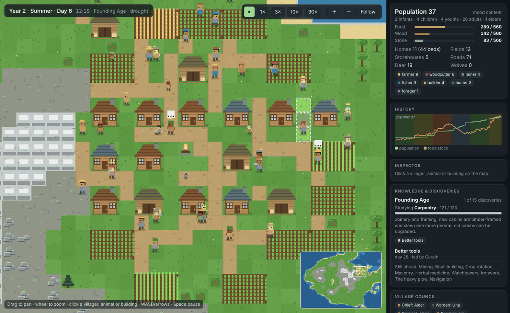

# Changelog

Each release is one step of a village simulation growing into a civilization simulation. Newest first. Screenshots are taken from each version itself (same seed, early game for the first image of a version; later-game for the feature view).

### v0.26 — Growth and housing
Births, pairing and newcomers now follow how well life is going; a Hardship setting (Gentle, Normal, Harsh) at world creation and live; builders plan ahead; health technology lengthens life; people have a wish for privacy (private houses, cabins in the trees, crowding and outdoor sleeping matter); a Housing concern with a Building drive. Six-seed comparison: population at year 12 went from 90 to 141.

### v0.25 — Livelihoods
About 35 trades (odd jobs, crafts, services) with real demand, goods and prices; side jobs, villager-invented jobs that catch on or fail, overtime by regime, aspirations, and craftspeople with aprons, tools and workbenches.

### v0.24.2a — Concern tracker
Concern cards now show a state (needs attention, responding, easing, didn't work), a severity bar with trend, countdown bars for running responses, council decisions, and resolved concerns stay for a while.

### v0.24.1 — Concerns
A badge, panel and toasts warn of falling population, food and firewood shortage and unity trouble, with feasts, rationing, orders and council nudges; secessions made rarer and smaller.

### v0.24 — Technology and ages
109 technologies in 8 branches across 9 ages, six house styles, four road tiers, knowledge that can be lost.

### v0.23 — Statistics and insight
A Stats tab with charts, event rates, records and CSV/JSON export, plus a multi-seed insight report.

### v0.22 — Lives and society depth
Hobbies, property, inheritance, feuds, policy that follows the regime, new time controls.

### v0.21 — Settlements and expansion
Outposts from camps to towns, bridges, and a new-world dialog with map size.

### v0.20 — Maritime and river commerce
Trade routes, harbour tiers, cargo ships and a ledger.

<b>Earlier versions</b>

### v0.19 — Map types
Archipelago, continent, peninsula, lakeland and river land, with neighbours on foot.

### v0.18 — Movement and population
Smoother paths, personal space, reserved spots, human-year ages, population flow.

### v0.17 — A living world
Trees that mature, soil that tires, wet and dry years, wolves that return, sightseers.

### v0.16 — Inspector overhaul
Building usage and popularity, residents, family links.

### v0.15 — Divided villages
Rival councils, strikes, civil strife, secession and sects.

### v0.14 — Divergent societies
Character, upbringing and regimes: no two villages turn out alike.

### v0.13 — Tabbed side panel
Village, Society, Progress, World and Events tabs, faster fog, packed saves, a seed-sweep harness.

### v0.12 — Building stats
Hit points, wear and repairs shown in the inspector.

### v0.11 — Diplomacy and trade with neighbours
Relations, treaties, visits, aid, tribute and raids with scholars, farmers, merchants and raiders.

### v0.10 — The wider sea
A 260×180 world with neighbouring islands under fog of war, found by sailors.

### v0.9.1 — Gathering places
A plaza and a tavern: villagers gather for evenings, sessions and holidays.

### v0.9 — Time travel and more projects
Fast-forward a year at a time, with a progress bar, and more great works.

### v0.8 — Factions and history
Circles turn into factions; a chronicle and lessons the village learns from famine, fire and fever.

### v0.7 — Great projects
Temples, granary halls and other monuments the council can choose to build.

### v0.6 — Trade, money and taxes
Markets, coins, taxes and a settings drawer.

### v0.5 — Technology, boats and camps
A technology tree that changes buildings, docks and fishing boats, resource camps, a diagnostics panel.

### v0.4 — Saving
Autosave, export and import of save files, resume prompt.

### v0.3 — Lives, opinions and a council
Life stages from infant to elder, personal desires and stories, opinions on four issues, friendship circles and an elected council.

### v0.2 — First playable village
A 160×112 island with four seasons, deer, fish and berries; villagers with five personality traits who decide by priority (danger, hunger, sleep, company, work); optional Claude narration.

