# Changelog

Each release is one step of a village simulation growing into a civilization simulation. Newest first. Screenshots are taken from each version itself (same seed, early game for the first image of a version; later-game for the feature view).

### v0.35.1 — Play fixes
Fixes after the first round of play testing. **Watch and Play switch back and forth seamlessly:** Watch is always fully automatic whatever the Play switches say, and your Play choices (Buildings, Research, Jobs) are kept for next time. The first time you enter Play the council stops building, a note says so, and a one-time tip card explains that you are in charge now; the council also no longer starts great works such as halls while you play. **Homes:** a crowded household can now move in with housemates who suit them, not only into an empty house; on the test world the Not enough homes concern went from every day to about one day in eight. **Touch:** pinch to zoom and two-finger pan. Also: a flaky culture test and the Play tests were made independent of the new switch defaults. Full run 31 suites green in 15m48s, 14 page tests green.

### v0.35 — Play
Play. This is the first version you can play, not only watch. A **Watch / Play** switch sits at the bottom of the map: Watch is the village on its own, exactly as before; Play lets you take the lead as much or as little as you like. **Orders.** Click a villager (Shift-click or Shift-drag a box for more) and right-click a tree, rock, berry bush, building site or damaged building to send them there. On a phone: tap the place, then press the order button in the inspector, or press and hold for a menu. A plain click or tap only ever selects and inspects, so nothing is ordered by accident. A command bar gives the common jobs (wood, stone, berries, farm, hunt, fish, a fixed job, **Free** to hand them back). **Build, Road, Zone.** Pick a building and a green or red footprint follows the pointer and says why a spot will not do; click to mark a site and builders pick it up first. Drag to lay roads. Paint **zones** (homes, farms, work, civic) and the village builds its own buildings inside them when there is room. **Research and the village plans.** Choose what the village studies. Three switches (Buildings, Research, Jobs) say what the village still plans for itself; amber means you are in charge of that part. The **Crowd** panel sets how the townsfolk who are not individually in play split their work between food, wood and stone. **Longer lives.** Villagers live about 8 to 12 years instead of about 4, and childhood lasts a little over a year. Births slow as a town grows and each family can only have three young children at a time, so the population still climbs smoothly to a plateau, as before. **Game over.** A village that empties, or stays below five people for a whole month (after its first year and a half), ends. The end screen tells what the village was: how long it lasted, its largest size, its era and its population over time. You can keep watching, start the same world again, or begin a new one. **Menu, manual and About.** A ☰ menu (Resume, New world, Save, Load, Settings, How to play, About), a manual covering mouse and touch, an About card with the version, what is new, links and a **Report a problem** button that copies a diagnostics report, and a first-visit welcome. **Fixes.** The Stats tab now counts the crowd's births and deaths. The village planners (paths, hamlets, bridges, upgrades, cabins) respect the Buildings switch. **Tests.** New suites `play_events` (43 checks), `gameover_events` and the page tests `ui_play`, `ui_over` and `ui_help`.

### v0.34.1 — Faster and launch-ready
Faster and launch-ready. The game is the same as v0.34; this release is about how fast it is tested and how it is presented. **Faster tests:** a new tool, `tools/checkpoint.js`, saves a world at a chosen day (`tests/checkpoints/`, 50 to 130 KB each) and eight slow suites (performance, discovery, outposts, lives, living, privacy, war, culture) now load one instead of simulating the early game. A reload always continues the same way, but not exactly like a straight run (villagers come back idle), so checkpoints serve as fixed starting points and the golden, save and performance suites still run from scratch. The wolf scan is an exact speedup (the golden trajectories are unchanged). The full run is **13 minutes 26 seconds, down from 16 minutes 58**. **Launch prep:** the README is now a short front page with a time-lapse of a village growing, a gallery and a release history, with the long feature notes moved to `docs/FEATURES.md` and the architecture notes to `docs/ARCHITECTURE.md`; an MIT license; `tools/make-gif.js` rebuilds the time-lapse. The project moved to a new repository named village-sim.

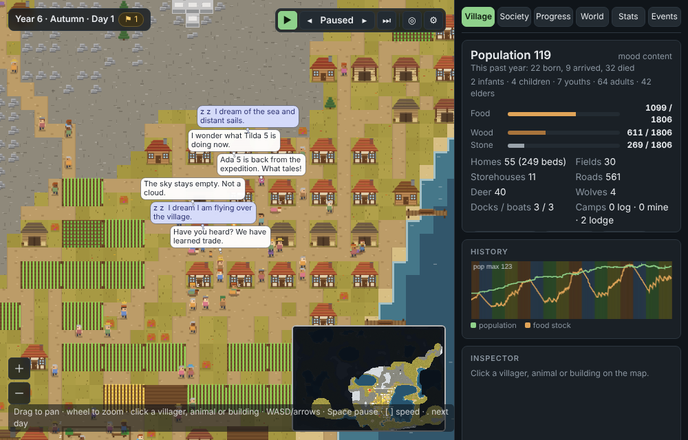

### v0.34 — Crowds
Crowds. A growing town no longer slows to a crawl. The 160 people with the most story (partners, children, a role, a hobby, a long life) stay **in play**, simulated one by one; everyone else is **the crowd**, kept as numbers by age: born, growing up, working the fields, woods and quarry, eating, falling sick and dying, drawn as small figures at the houses, and called forward as named villagers (or sent back) as the town changes. The population reads like **87 (37 in play)** and the age breakdown counts everyone. Measured on a forced crowd of 2,800 people: about 1.1 ms per tick and a 650 KB save. Housing now follows crowding: the Not enough homes concern is answered when a quarter of the adults share rooms against their sociability, a house is built, crowded families move into empty homes, and the farm limit rises with the population, so building is smoother. Checked that nobody vanishes: births plus arrivals minus deaths and leavers matches the population exactly, and groups founding outposts are counted. The test runner gained a resume mode that reruns only what is not yet green.

### v0.33 — City structure
City structure. The village now grows into a town in a shaped way. Every 4x4 tiles gets a **land value** from the pull of the camp, market, plaza, tavern and other services, roads and the shore, minus the nuisance of fields, camps and forges; the new City card in the World tab shows the layout, the mix of home styles and a **land value map** button. The dearest ground gets the best style the village knows, the edge keeps log cabins, old homes are rebuilt in place, ruins are cleared and fields the town has grown around are given up. **Hamlets** (named by direction) are founded when the close ground fills up; they get their own store. Villagers' footsteps pave **desire paths**, and busy roads get better surfaces first. A new **workshop** building gathers the crafts. When beds run short the Housing concern now says what is in the way. Settings shows a one-line **world line** (click to copy, or paste a whole line into the Seed box) with a collapsed Diagnostics snapshot and a saved log of your own choices. The Concerns list keeps its scroll position at fast speeds.

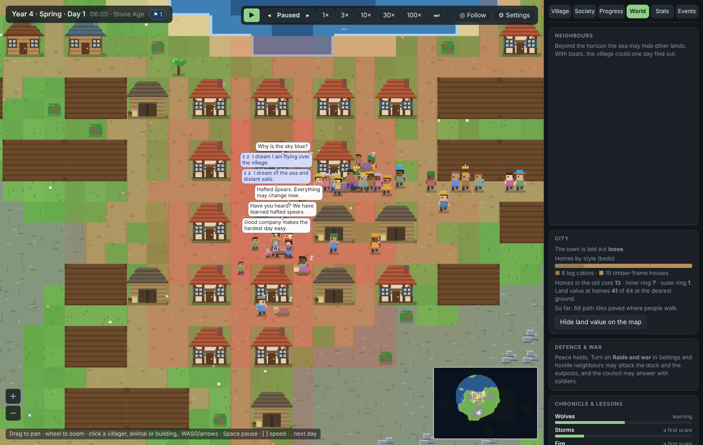

### v0.32 — Settlements, causes of death and housing
Settlements, causes of death and housing. Click another settlement on the map (or its name in the World tab) for a full panel: people, temper, strength, treaty and dealings, what each side knows that the other does not, origin and history. A new **Causes of death** card in the Society tab shows totals by cause, this year against last year, age groups, the main preventable cause with advice and recent deaths. When the ground near the village is full, new homes are now sited further out (suburbs and hamlets) and the Housing concern says so. Fixes: the tree of knowledge window fits the stage on small screens, 'Recently eased' stays open, culture no longer saturates, plague is a little likelier. Tests: `tests/ui_settle.js` and `tests/housing_events.js`.

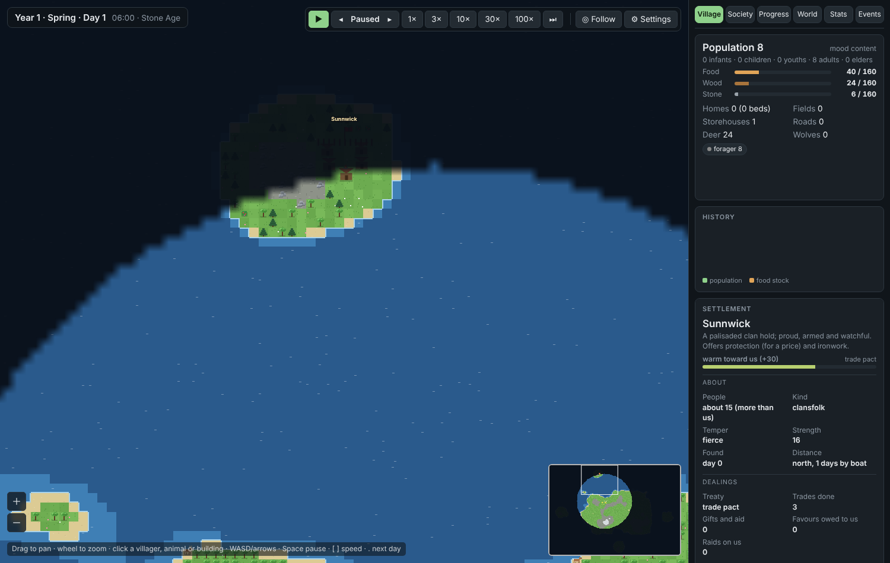

### v0.31 — Society depth
Society depth. A **culture** score grows from weddings, funerals and winter story nights (and slowly fades unless kept up); culture, curious minds and a library add a little to research. With **Disasters** on, spring floods and a **plague** can strike; the council chooses between quarantine and carrying on. With coinage, five or more in one trade found a **guild** that pays dues into the treasury. Outposts of eight or more get a **council head** of their own. The council can sell lessons to a friendly neighbour, hostile neighbours send **spies** who may steal a craft (the law and watch catch some), and the council may spy on a rival. Authority is re-tuned so crises push it up less and culture pulls it down a little. New 'Culture & guilds' card in the Society tab, statistics, chronicle entries and a plague concern. Tests: `tests/culture_events.js` (28 checks) and `tests/ui_culture.js`.

### v0.30 — Conflict
Conflict arrives, abstractly. With the **Raids and war** switch on (off by default; peace is still the default and the simulation is unchanged without it), a hostile neighbour the village has met makes the council muster a watch of real villagers, up to a target that grows with the danger, the defence policy and the regime. Arms follow technology (militia, spearmen, archers, swordsmen, legionaries, musketeers); soldiers wear a helmet and carry a spear on the map. A **Barracks** drills the ranks and a **Watchtower** gives early warning; both are new great projects with their own art. Upkeep comes out of the food store (cheaper under authority) and morale rises and falls with food, victories and defeats.

Battles are abstract (two sides, three rounds, casualties on both) and settle raids on the village (friends with a treaty may stand with it), attacks on outposts (which may be driven off, hurt or overrun) and the council's own campaigns: after enough raids or a grudge, the council is asked whether to march on the neighbour, send envoys with gifts, or hold. A campaign takes days, the soldiers are away and do not defend meanwhile; victory brings plunder and a spell of tribute, defeat costs lives and respect. New concerns ("poorly defended", "army going hungry"), statistics, chronicle entries and a **Defence & war** card in the World tab.

Also fixes an old bug: victims of raids and strife were given 0 health but regained a little before the death check, so many of those deaths never happened. Tests: `tests/war_events.js` (51 checks) and the page test `tests/ui_war.js`. Control of the army (orders, stance) is planned for v0.33.

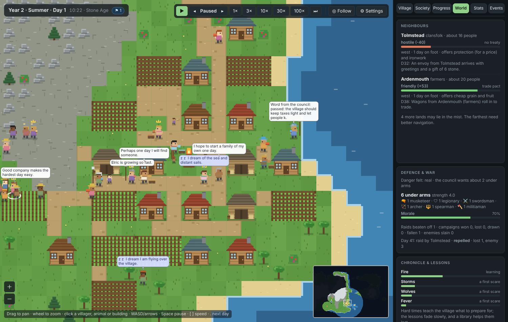

### v0.29.2 — Varied bubbles and quicker tests
Villagers' thoughts no longer repeat across a crowd: every thought carries other wordings for the same subject (about 35 new lines for hunger, tiredness, loneliness, cold, contentment, low spirits, housing, privacy, drought, winter and the seasons), a bubble picks a wording that has not been on screen in the last 90 seconds, and no more than two bubbles on the same subject show at once. The small white emote box over a villager now shows only for the selected villager (alarms still show for all). The simulation is identical to v0.29. Tests: the full run is about 17 minutes (was 22), the wolf check and the performance gate are shorter.

### v0.29.1 — Test suite overhaul
Tools only; the game is identical to v0.29. The tests now run two at a time and print each result as it finishes, with a timing table. `tools/check.sh` runs only the suites the changed files can affect, `full` runs all 24 (about 22 minutes instead of 28 to 45), and `pages` runs the browser page tests. One loader builds the source list from the script tags in `index.html`. New golden-trajectory tests (six map types, 30 days each) and a performance gate (10 years, fail above 1.5 ms per tick) join the suites. A full green run is stamped with a hash of the code, and `tools/release.sh` now refuses to release unless that stamp matches the exact code being released, so a failing or untested build cannot go out. Old debug and screenshot scripts moved to `tests/legacy/`.

### v0.29 — Voices and thoughts
Villagers now think, dream and talk. About thirty kinds of thought come from their real state (hunger, mood, work, family, grief, a coming baby, the winter stores, festivals, discoveries, expeditions and new material finds, rumours, plans, quarrels, money, old age); sleepers dream; two villagers who stop to chat speak and answer, and a pair who dislike each other speak coldly. Bubbles scale with speed: full lines at 1&times; and below (six at a time), a few words at 3&times;, a single glyph at 10&times; and 30&times; (three at a time, nearest the middle of the screen), none at 100&times;. Click a bubble to select the villager and pin the line; the inspector has a **Mind** block, and the Events tab has **Talk of the village**: a live feed at slow speeds, daily summaries at all speeds. Claude-written lines are an optional toggle, off by default. Thoughts use no random numbers, so the village runs exactly as before. Also: the Food readout no longer shows long decimals.

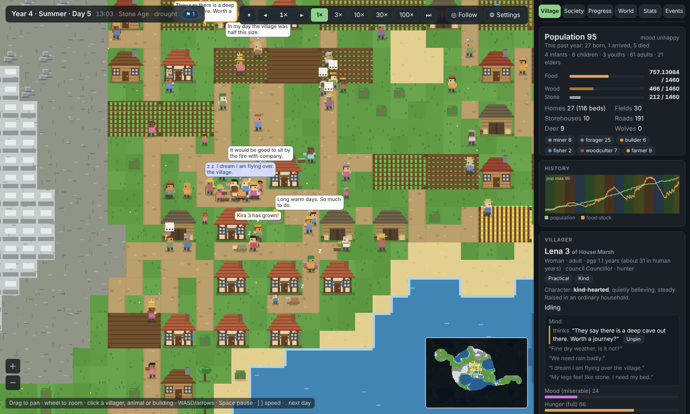

### v0.28.1 — Scarcer materials, new discoveries and a world check
Materials are now rare: each map holds one deposit per material (saltpetre, coal, copper, oil), and a party only recognises it once the village knows the matching craft (masonry, mining, bronze, steam); until then it brings home "strange stone nobody can name yet". Neighbours sell a material only when relations are friendly. New places appear over time: diving bells reveal deep wrecks, sonar the sea bed, aviation a lost city, and a deep drought can uncover a hoard in the shrunken waters. The new-world dialog gets a **Check this world** button that lists a map's special features (land share, fishing, stone, neighbours, whether barges can serve a land neighbour, hidden places and deposits). A yearly population-flow line in the probe (births, deaths by cause, arrivals, outpost population) is there to track the year 7&ndash;14 dips. On island seed 12 coal now arrives at year 9 and saltpetre at year 10 (v0.28: copper and oil by year 2&ndash;4).

### v0.28 — Expeditions, discovery and a living sea
Every map hides about 23 places worth a journey (ruins of an older people, caves, outcrops, hoards, wrecks, fishing and whaling grounds) plus the village's own past (a trading ship it lost, an outpost that died out). Rumours reveal them; the council weighs expeditions and sends a leader, with a few escorts on land or a boat at sea; they come home with goods, old writings (even a forgotten technology), food or a source of **saltpetre, coal, copper or oil**, the new inputs that gate gunpowder, steam, steel, electricity, engines and aviation. Fish recover faster where the water is full, deer winter in sheltered pockets and return in spring, river barges carry bulk goods to neighbours reached by water, friendly neighbours sell lessons for coins, and a discovery now says what it opens. New statistics series and an Expeditions &amp; discoveries card.

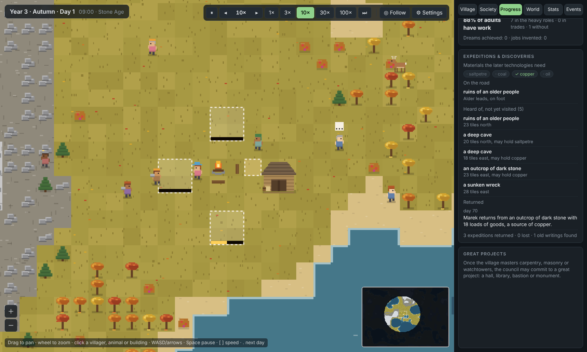

### v0.27 — Unlocks, research limits and a shaped land
Every technology now says what it gives and what it needs (a coast, rock, a mine, a library, enough people); research has limits (scholar capacity, rising costs, missing inputs), so a typical civilization finishes about 60&ndash;70% of the tree; the council's circles and a chosen philosophy steer the agenda; an Open knowledge sandbox option and a Grant button; a clickable tree of knowledge; terraforming works (levelled ground, drained shore, terraces, dikes, polders, earthworks); tower blocks; outposts with their own temper.

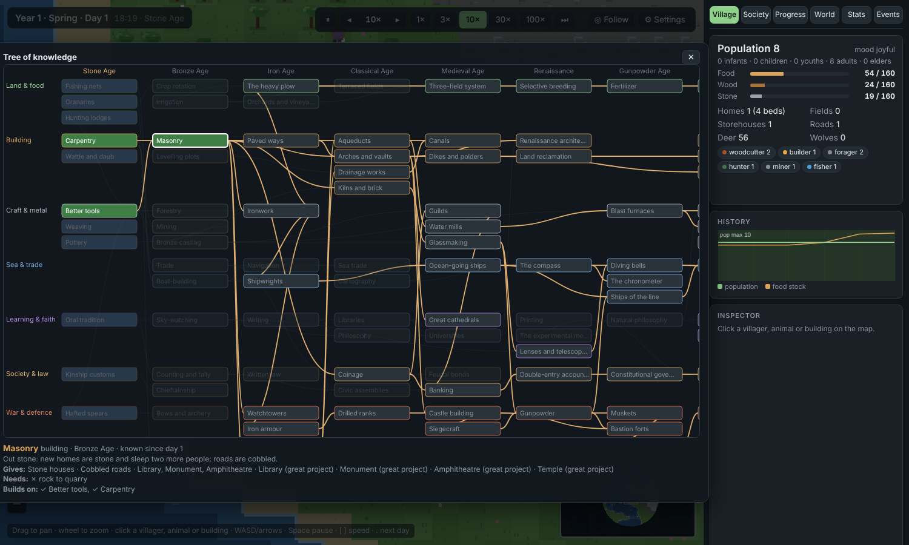

### v0.26 — Growth and housing
Births, pairing and newcomers now follow how well life is going; a Hardship setting (Gentle, Normal, Harsh) at world creation and live; builders plan ahead; health technology lengthens life; people have a wish for privacy (private houses, cabins in the trees, crowding and outdoor sleeping matter); a Housing concern with a Building drive. Six-seed comparison: population at year 12 went from 90 to 141.

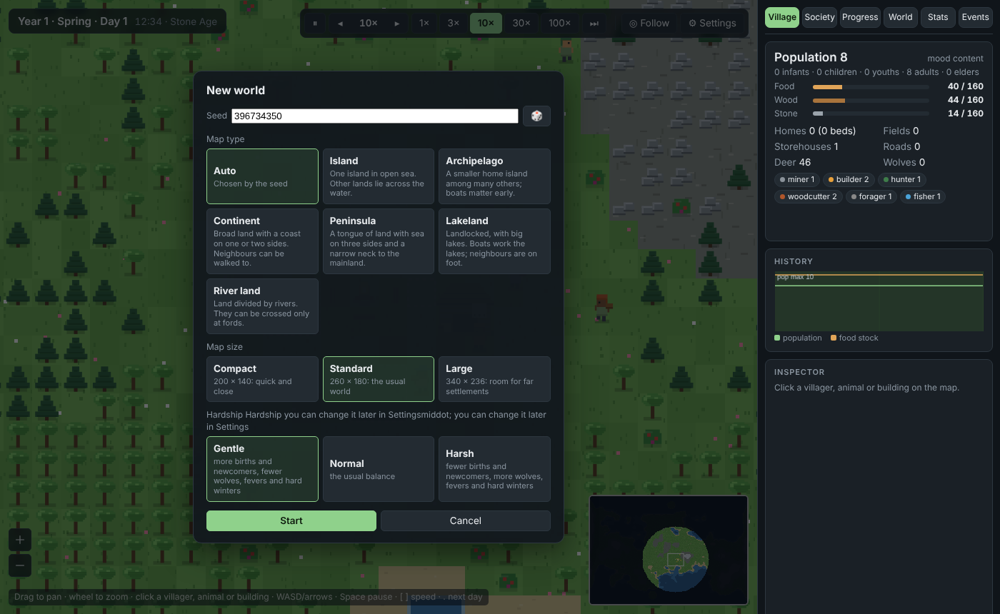

### v0.25 — Livelihoods
About 35 trades (odd jobs, crafts, services) with real demand, goods and prices; side jobs, villager-invented jobs that catch on or fail, overtime by regime, aspirations, and craftspeople with aprons, tools and workbenches.

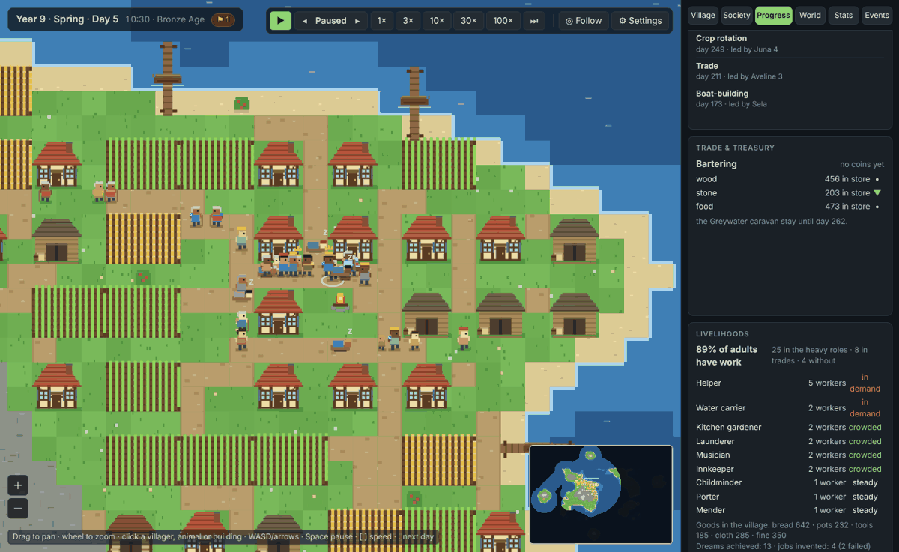

### v0.24.2a — Concern tracker
Concern cards now show a state (needs attention, responding, easing, didn't work), a severity bar with trend, countdown bars for running responses, council decisions, and resolved concerns stay for a while.

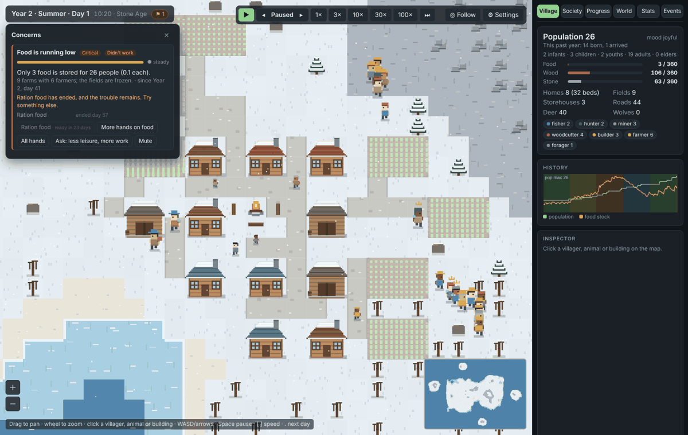

### v0.24.1 — Concerns
A badge, panel and toasts warn of falling population, food and firewood shortage and unity trouble, with feasts, rationing, orders and council nudges; secessions made rarer and smaller.

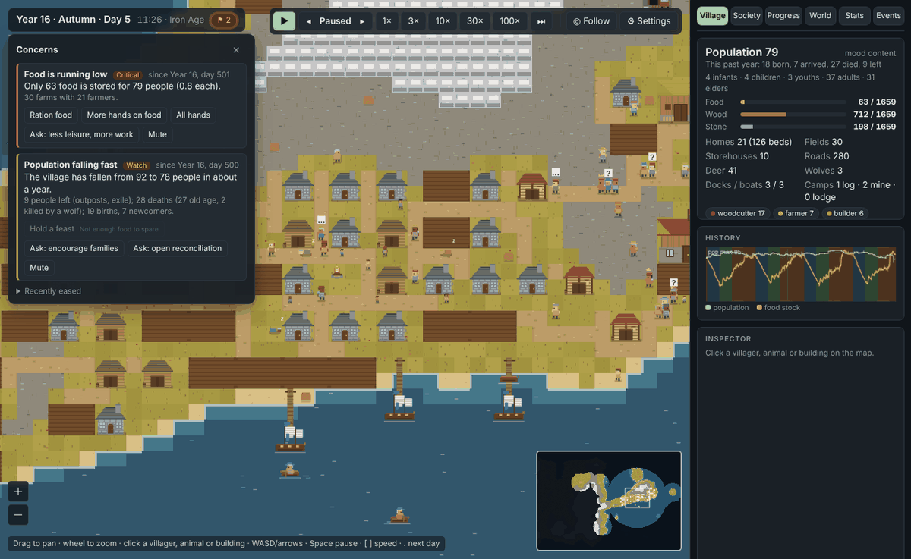

### v0.24 — Technology and ages
109 technologies in 8 branches across 9 ages, six house styles, four road tiers, knowledge that can be lost.

### v0.23 — Statistics and insight
A Stats tab with charts, event rates, records and CSV/JSON export, plus a multi-seed insight report.

### v0.22 — Lives and society depth
Hobbies, property, inheritance, feuds, policy that follows the regime, new time controls.

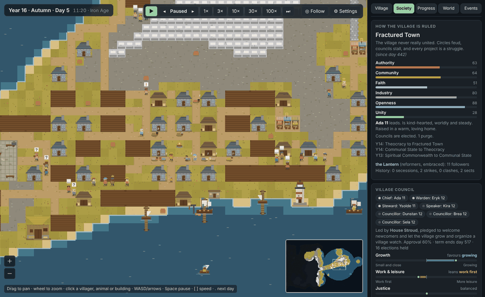

### v0.21 — Settlements and expansion
Outposts from camps to towns, bridges, and a new-world dialog with map size.

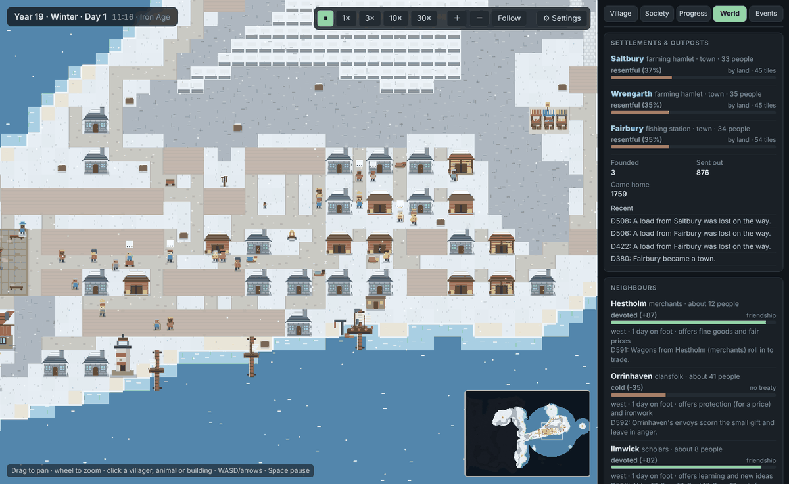

### v0.20 — Maritime and river commerce
Trade routes, harbour tiers, cargo ships and a ledger.

<b>Earlier versions</b>

### v0.19 — Map types
Archipelago, continent, peninsula, lakeland and river land, with neighbours on foot.

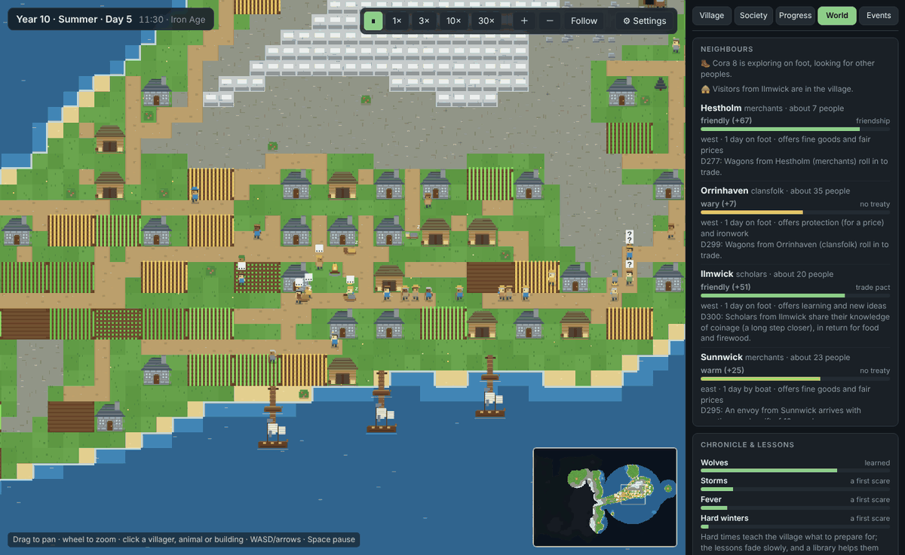

### v0.18 — Movement and population
Smoother paths, personal space, reserved spots, human-year ages, population flow.

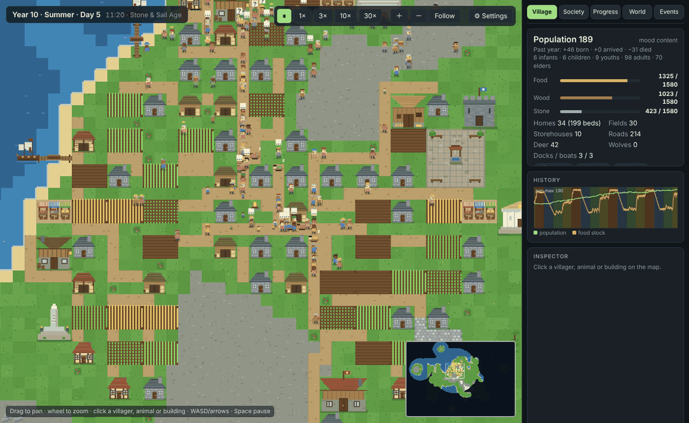

### v0.17 — A living world
Trees that mature, soil that tires, wet and dry years, wolves that return, sightseers.

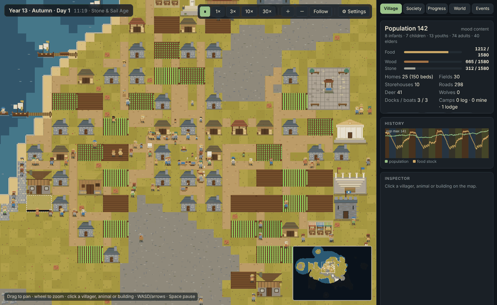

### v0.16 — Inspector overhaul
Building usage and popularity, residents, family links.

### v0.15 — Divided villages
Rival councils, strikes, civil strife, secession and sects.

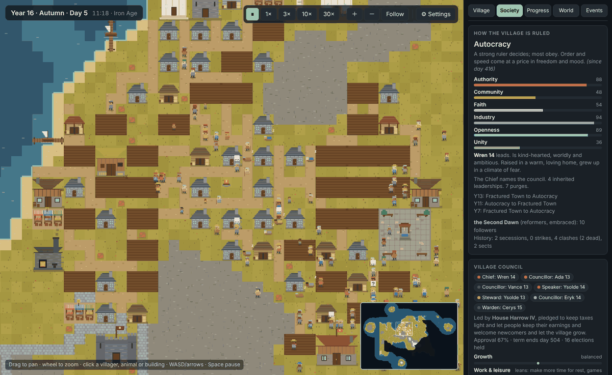

### v0.14 — Divergent societies
Character, upbringing and regimes: no two villages turn out alike.

### v0.13 — Tabbed side panel
Village, Society, Progress, World and Events tabs, faster fog, packed saves, a seed-sweep harness.

### v0.12 — Building stats
Hit points, wear and repairs shown in the inspector.

### v0.11 — Diplomacy and trade with neighbours
Relations, treaties, visits, aid, tribute and raids with scholars, farmers, merchants and raiders.

### v0.10 — The wider sea
A 260×180 world with neighbouring islands under fog of war, found by sailors.

### v0.9.1 — Gathering places
A plaza and a tavern: villagers gather for evenings, sessions and holidays.

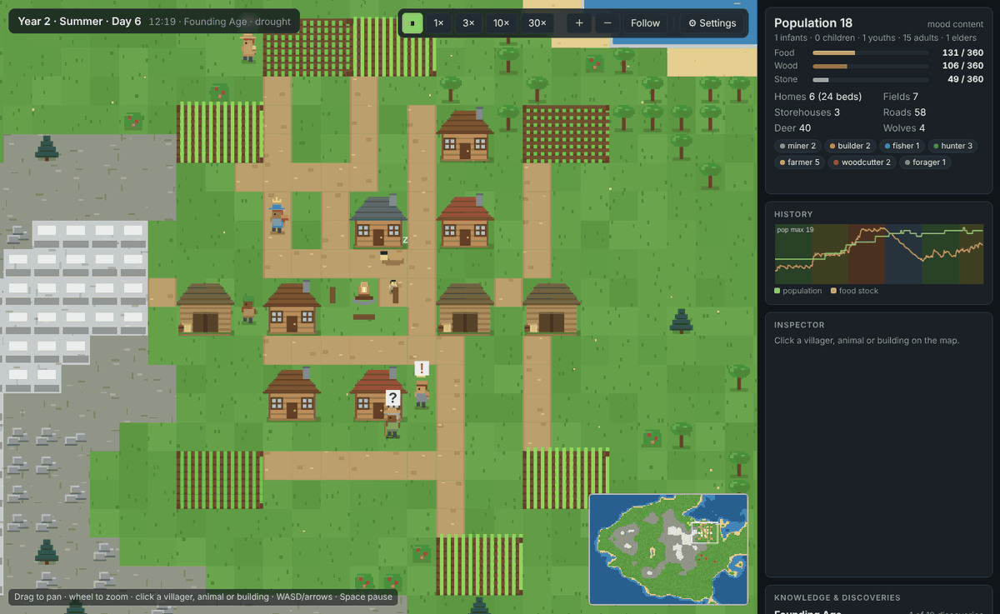

### v0.9 — Time travel and more projects
Fast-forward a year at a time, with a progress bar, and more great works.

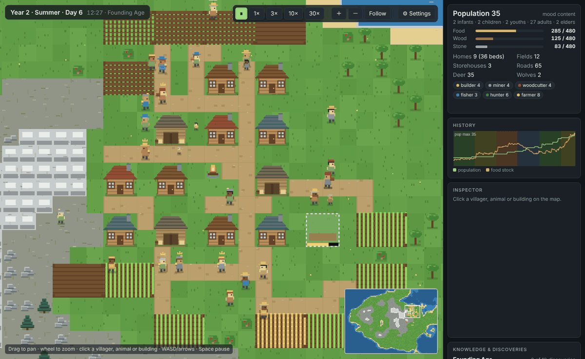

### v0.8 — Factions and history
Circles turn into factions; a chronicle and lessons the village learns from famine, fire and fever.

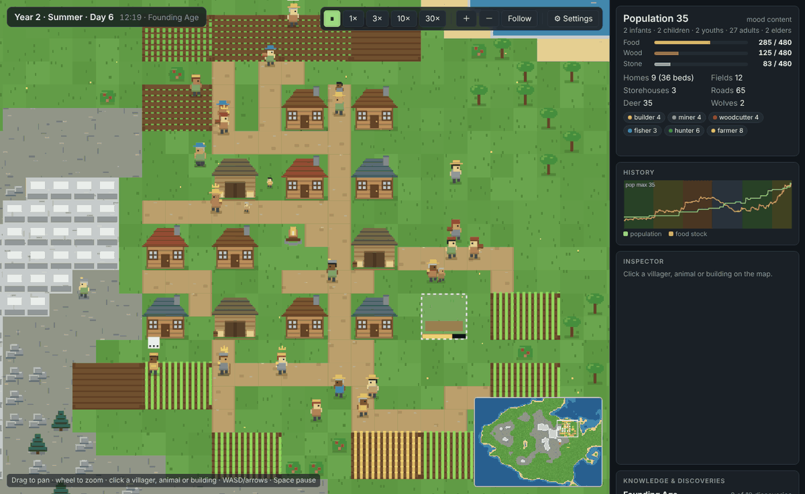

### v0.7 — Great projects
Temples, granary halls and other monuments the council can choose to build.

### v0.6 — Trade, money and taxes
Markets, coins, taxes and a settings drawer.

### v0.5 — Technology, boats and camps
A technology tree that changes buildings, docks and fishing boats, resource camps, a diagnostics panel.

### v0.4 — Saving
Autosave, export and import of save files, resume prompt.

### v0.3 — Lives, opinions and a council
Life stages from infant to elder, personal desires and stories, opinions on four issues, friendship circles and an elected council.

### v0.2 — First playable village
A 160×112 island with four seasons, deer, fish and berries; villagers with five personality traits who decide by priority (danger, hunger, sleep, company, work); optional Claude narration.

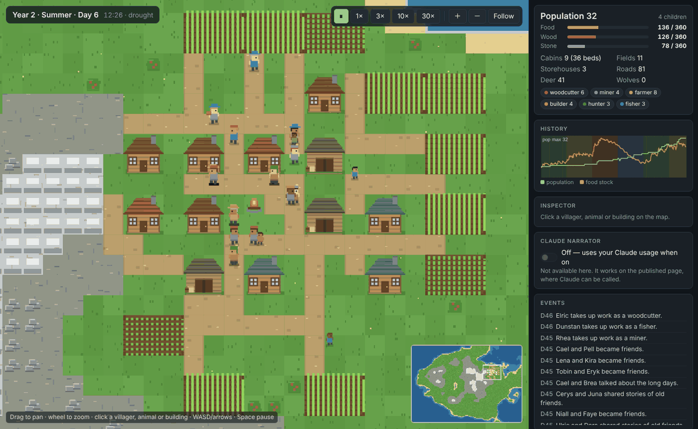

