# Changelog

Each release is one step of a village simulation growing into a civilization simulation. Newest first. Screenshots are taken from each version itself (same seed, early game for the first image of a version; later-game for the feature view).

### v0.39.1 — Tidier panels and clearer deaths
A tidy-up of the side panels and Stats, a clearer account of why people die, and a fix for the game losing time at high speed.

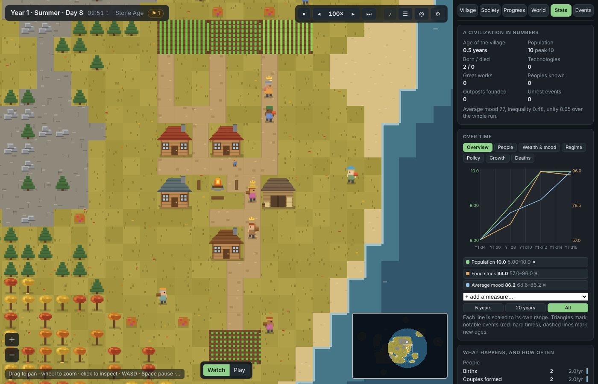

**Layout.** Two layout modes, Docked and Clean (the Overlay mode tried in this cycle was removed: it added buttons without saving space). The menu is down to eight items with the version at the bottom, Diagnostics is one card, the inspector scrolls the selected villager into view, and the Time travel and Fast-forward area has no stray whitespace.

**Stats.** New Overview and Deaths presets; illness deaths are split three ways; hovering a stat name shows its history graph; the Treasury has a sparkline; a crash when opening Stats on older saves is fixed.

**Lists and dates.** Chronicle, battles, discoveries, trades and harbour trips show the latest few entries with the rest under an "Earlier" fold, and dates read as Y56 D8 (year and day) everywhere. The Culture card explains what builds the score.

**Speed.** The main loop no longer drops time when a frame runs long: it carries the remainder instead, and a long gap between frames is allowed to catch up. Diagnostics now report ticks per frame, time spent ticking, frame time and the longest gap, to help find why one machine runs well below its speed setting (see #137).

**Tests.** New UI suite for the layouts, menu, presets, hover graphs, compact lists and merged Diagnostics.

Issues: #157, #158, #159, #160, #161, #162, #163, #164, #165, #166, #167, #168, #169

### v0.39 — Late ages and language
Two new ages, a Spanish version, a full screen option and a fairer start for small villages.

**Late ages.** The tech tree continues past the Modern Age with the Atomic Age (nuclear power, jets, rockets, the green revolution, high-rise housing) and the Information Age (the internet, robotics, renewables, fusion, vertical farms, arcologies, spaceflight): 39 new technologies, 148 in all across eleven ages. Farms keep gaining yield far beyond the old ceiling, and two taller kinds of home appear: the high-rise (32 beds) and the arcology (64 beds).

**Spanish.** The game starts in Spanish when the browser is set to it, and Settings has a language switch (English or Español) that is remembered. The main screens, menus and Settings are translated and the rest follows in later releases. English text is the key, so anything not yet translated simply stays in English.

**Full screen.** Menu > Full screen, or the X key (not available on iPhone Safari).

**Settings study.** A matrix of worlds with each switch alone and all together showed that survival is the main brake on growth (about three times fewer people after 22 years), disasters and crime cost less than they seemed to, and raids barely matter early. Variance between single runs is large, so the changes are modest: harsh winters and droughts are less frequent, fevers and fires depend on how big the village is (little to burn or catch when it is small), survival's hazard multiplier is 1.5 and its food limit on births 1.15. Settings now tag how much harder each switch makes the game, with a note while the hard ones are on. A village that falls below eight people gets its own concern and more travellers when it has room and food, so a collapse can be avoided.

**Tests.** Two concerns tests and the city test moved to worlds the changed sim still gives enough people; the districts UI test no longer clicks through a speech bubble; golden baselines were re-recorded for the sim changes; new i18n and language UI tests.

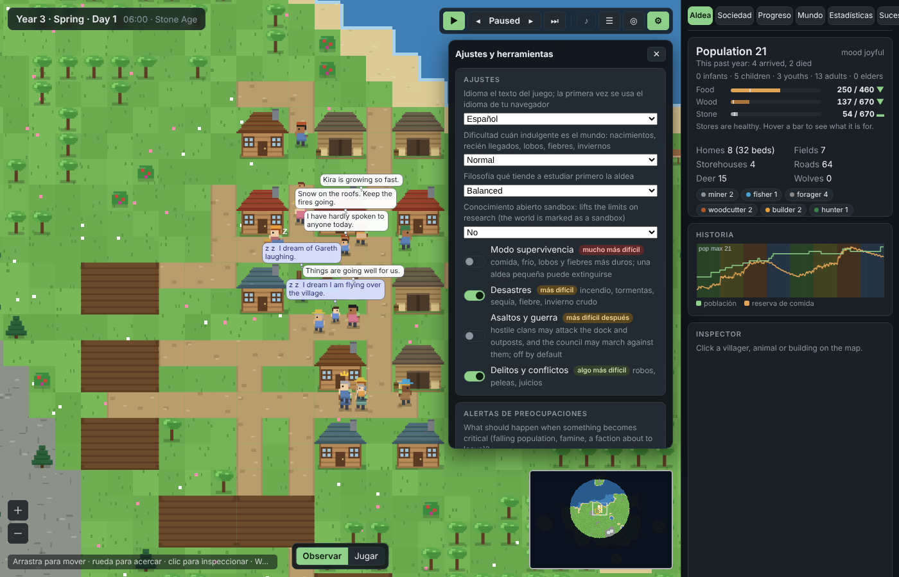

### v0.38.2 — Diagnostics you can copy, and the pace lab
**Diagnostics.** The text in the World card no longer rewrites itself under your selection (it only changes when its content does, and never while part of it is selected), and a Copy diagnostics button sits below it.

**Pace lab (developer tool).** `tools/pace_lab.js` runs the same worlds under the current birth model and a candidate and draws population curves, yearly growth rates and a table (`docs/pace-lab.html`, run data in `docs/pace-lab/`). It found that the crowd's birth rate began with a one-day spike when the crowd formed; the candidate fix did not smooth growth enough to adopt, so the game itself is unchanged. It also showed that with survival, disasters, crime and raids all on, growth stalls (island 12: 92 people at year 30), which is the next thing to study.

### v0.38.1 — Fixes and polish
Fixes and polish after v0.38, with no change to the simulation.

**Diagnostics.** The Diagnostics text in the World card (Settings) now fills the moment you open it and refreshes every second; before, it waited up to ten seconds and any problem left it blank. If the snapshot cannot be built it says why.

**Stats graph.** The first two years are marked in days, and the value range of the first two lines is shown at the left and right edges in their colours.

**Land value.** The overlay is stronger, and the City card explains the colours. Early on only the ground around the camp has any value.

**World tab.** The Neighbours card now sizes to its content (it used to reserve a tall empty box) and moves to the bottom until you meet someone.

**Resource notices.** One steady two-line notice under the food, wood and stone bars (the worst store first, held for a few seconds) replaces the notes that appeared and disappeared and shifted the panel. A quiet line fills the space when all is well.

**Copyright.** © 2026 Zaat, MIT license, in About, the README and every source file.

### v0.38 — Pace
Pace. Towns now grow at a believable pace. In v0.37 a lucky village could pass a thousand people in under fifteen years; now a thousand people takes about thirty years on Gentle, thirty-five on Normal and forty-five or more on Harsh, and a big town has to keep the peace to keep growing.

**A real childhood.** People now take much longer to grow up (about two and a half game years instead of one), have a narrower span of fertile years, and some children die of fevers and accidents before they grow up. Medicine and good health technology lower that risk.

**Slower families.** A couple spaces their children out: pregnancy takes longer, the gap between births is wider, and a family supports two small children at a time instead of three.

**Fewer travellers.** Newcomers arrive less often and in smaller groups, and they come as grown adults. A town is no longer fed mostly by strangers.

**Order.** Past a certain size a town can no longer keep the peace on its own. Crime and distrust slow births and newcomers until laws, guards, defence technology and firmer rule catch up. The new Order series in the Stats tab shows it (1 means the town keeps the peace; lower means growth is slowing).

**Difficulty.** Hardship is wider apart. Gentle grows clearly faster (more births and newcomers) and Harsh clearly slower.

| Average population | Gentle | Normal | Harsh |
|---|---|---|---|
| Year 10 | 96 | 71 | 39 |
| Year 20 | 553 | 267 | 84 |
| Year 30 | 1,180 | 782 | 268 |

Six worlds, two maps, seed 12. Single runs vary; the island runs faster than the continent.

**Old saves.** Saves from earlier versions carry over: everybody keeps their stage of life.

**Tests.** A new pace suite checks the childhood, child deaths, the order brake, the slow start and old saves. The golden baseline and the difficulty scorecard were rebuilt for the new pace. A few suites that only need a big town quickly use the earlier fast settings.

**What is next.** Late farming that matches real modern farming, then energy and the atomic and information ages.

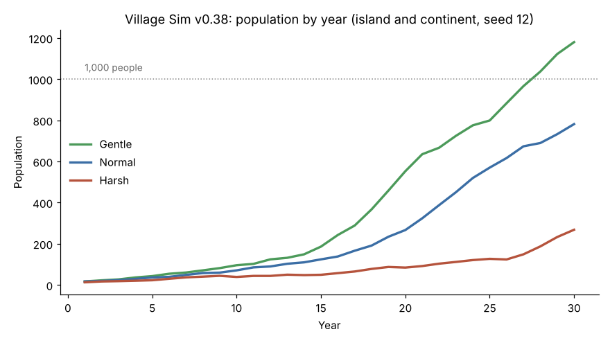

### v0.37 — Metropolis
Metropolis. Villages now grow into towns of two to three thousand people instead of stalling at a few hundred, and the game has the tools to run, show and measure a big town.

**Big towns.** Most of a large town is now a crowd that is counted, not followed: the same people as the named villagers, with the same food, homes and work, but kept as numbers, dots and district colours so the game stays fast. People with stories stay individual. A continent town grows from about 340 people in year 6 to over 3,000 in year 31, at about 1.3 ms per tick.

**Districts.** The new districts overlay on the World tab tints the map by district and shows names with head counts. Click one for its card: people, mood, homes, jobs, food and wood. In Play you can give a district an order, and each district can be Auto or Mine, like the Village plans switches.

**Storage.** Wood and stone pile up in yards, while food needs storehouses and granaries and spoils if it is kept badly. Better-built storehouses (timber, then stone granaries) hold more in the same ground, and technology raises capacity. This replaces the single cap that grew with population.

**Food and wood by sea.** Fishers now draw on the real fish stock, limited by shore frontage, by boats berthed at docks and by what the sea can replace each day. The planner builds up to eight docks and needs fewer fields for what the sea gives. Boats also fetch wood from far shores when the near forests run short.

**Resources as a table.** Each resource now has a source, a stock, its consumers, a shortage concern and substitutes by technology, so new materials can be added by age without touching the rest.

**Room to grow.** Homes may clear woodland when the close ground is full, and a failed field placement no longer blocks home building. Woodland is cleared only while at least half the forest stands, and the crowd replants more when trees get scarce. The search window and the hamlets grow with the town. Newcomers arrive when there are spare beds, full larders and good prospects. A bug that divided mood and health by the whole crowd, so big towns looked gloomy and had too few births, is fixed.

**Speed.** Builders no longer re-search the whole map for sites that are too far to walk to, searches toward a building lean toward it, and building lists are cached. A new test, `perf_metropolis`, times a 2,900-person town.

**Difficulty.** Hardship is now measured: a scorecard in the coverage report checks that Gentle passes 1,000 people, Harsh is hard but survivable, and Normal sits between them. In twelve 20-year worlds, median population at year 20 was about 2,300 on Gentle and Normal and about 1,200 on Harsh. Two 30-year worlds finished with no faults.

**Phone fixes.** The About and Menu cards now scroll and close on a phone (#187), a stuck finger no longer breaks pinch and pan (#188), Diagnostics is filled in (#189), and a masked script error is now logged with where it came from.

**Tests.** 38 suites plus 17 page tests, all green. The new and changed suites cover fishing, storage, districts, housing and resources; the calibration batch and the golden world were re-baselined.

**What is next.** A slower, more realistic growth pace (the early game is still quicker than real populations), late farming that matches modern yields, then energy and the atomic and digital ages (v0.38) and space (v0.39).

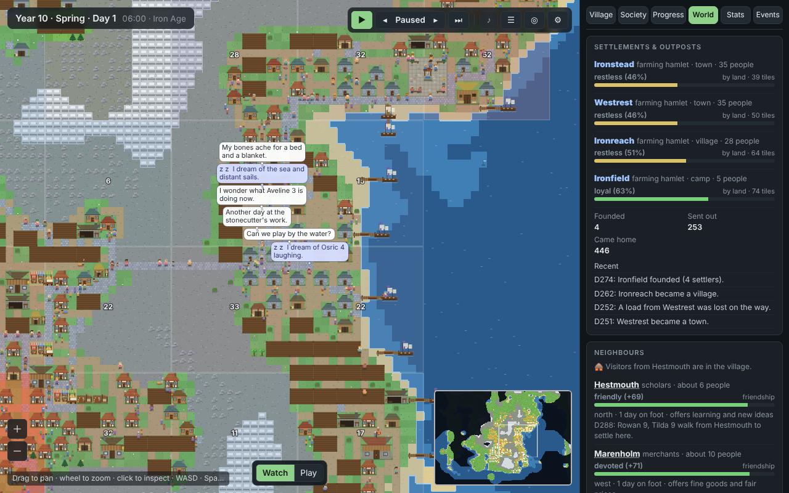

### v0.36 — Insight, look and sound
Insight, look and sound. This is the first public release. Villages now keep growing instead of stalling around 250 people, the game has generated music and a cleaner look, and it can measure itself. **Growth:** couples try for children every day and singles pair up, so villages reach 450 to 650 people in 30 years instead of stalling near 250. **Hardship** also changes the harvest. **Music:** generated stereo music (M), following the village. **Controls:** icons on the build palette, Max speed, touch building with Undo, scenarios in the Menu, game-over tales. **Fixes:** lumber camps for far trees, faith and openness. **Insight:** coverage and dev-stats tools. 32 suites in about 11 minutes. Details in `docs/releases/v0.36.md` and `docs/coverage.md`.

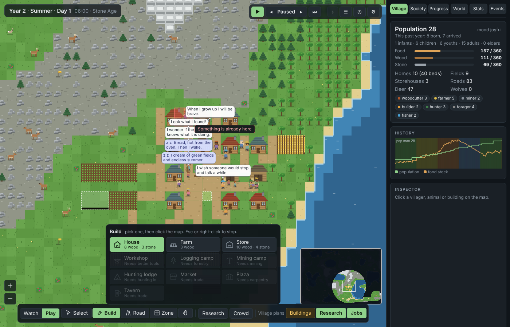

### v0.35.1 — Play fixes
Fixes after the first round of play testing. **Watch and Play switch back and forth seamlessly:** Watch is always fully automatic whatever the Play switches say, and your Play choices (Buildings, Research, Jobs) are kept for next time. The first time you enter Play the council stops building and a small tip explains that you are in charge; it pauses the village once, never covers the map, and comes back on later visits until you press **Don't show again** (Menu > Show tips again brings tips back). The council also no longer starts great works such as halls while you play. **Homes and privacy:** a crowded household can now move in with housemates who suit them, not only into an empty house; on the test world the Not enough homes concern went from every day to about one day in eight. The wish for privacy is a little gentler (nobody is completely unable to share a roof) and survival comes first: someone who is starving, ill or exhausted no longer minds who they share with. A probe over 8 years on two worlds found fewer than 40 hungry adult-days among about 60,000, so hunger is already handled before wants. **Touch:** pinch to zoom and two-finger pan; a tap places the build ghost where the finger is; the red build tooltip stays on screen, sits above the finger and no longer sticks after you return to Watch. Full run 31 suites green, 14 page tests green.

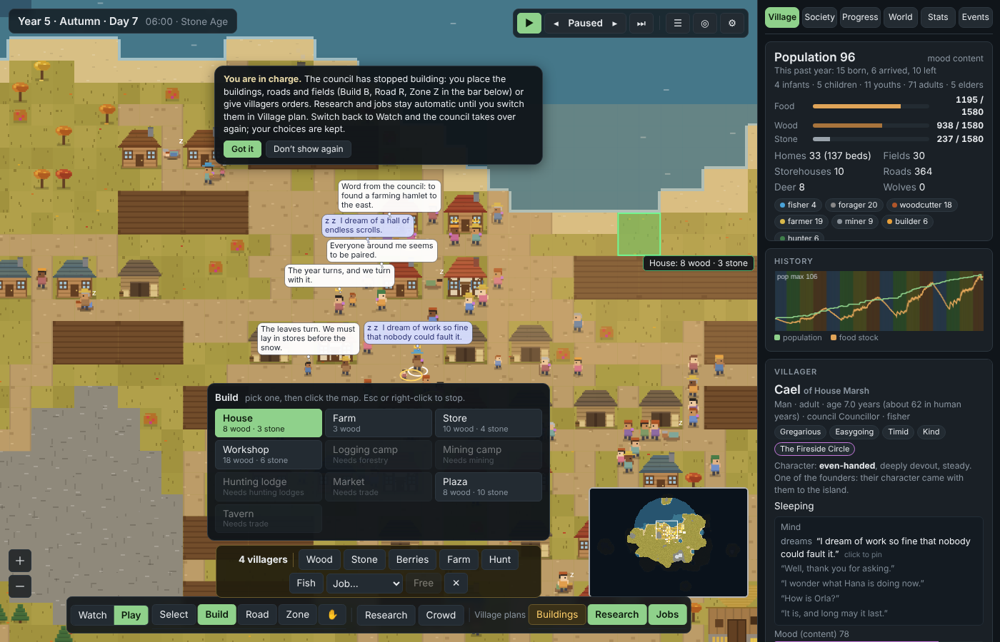

### v0.35 — Play
Play. This is the first version you can play, not only watch. A **Watch / Play** switch sits at the bottom of the map: Watch is the village on its own, exactly as before; Play lets you take the lead as much or as little as you like. **Orders.** Click a villager (Shift-click or Shift-drag a box for more) and right-click a tree, rock, berry bush, building site or damaged building to send them there. On a phone: tap the place, then press the order button in the inspector, or press and hold for a menu. A plain click or tap only ever selects and inspects, so nothing is ordered by accident. A command bar gives the common jobs (wood, stone, berries, farm, hunt, fish, a fixed job, **Free** to hand them back). **Build, Road, Zone.** Pick a building and a green or red footprint follows the pointer and says why a spot will not do; click to mark a site and builders pick it up first. Drag to lay roads. Paint **zones** (homes, farms, work, civic) and the village builds its own buildings inside them when there is room. **Research and the village plans.** Choose what the village studies. Three switches (Buildings, Research, Jobs) say what the village still plans for itself; amber means you are in charge of that part. The **Crowd** panel sets how the townsfolk who are not individually in play split their work between food, wood and stone. **Longer lives.** Villagers live about 8 to 12 years instead of about 4, and childhood lasts a little over a year. Births slow as a town grows and each family can only have three young children at a time, so the population still climbs smoothly to a plateau, as before. **Game over.** A village that empties, or stays below five people for a whole month (after its first year and a half), ends. The end screen tells what the village was: how long it lasted, its largest size, its era and its population over time. You can keep watching, start the same world again, or begin a new one. **Menu, manual and About.** A ☰ menu (Resume, New world, Save, Load, Settings, How to play, About), a manual covering mouse and touch, an About card with the version, what is new, links and a **Report a problem** button that copies a diagnostics report, and a first-visit welcome. **Fixes.** The Stats tab now counts the crowd's births and deaths. The village planners (paths, hamlets, bridges, upgrades, cabins) respect the Buildings switch. **Tests.** New suites `play_events` (43 checks), `gameover_events` and the page tests `ui_play`, `ui_over` and `ui_help`.

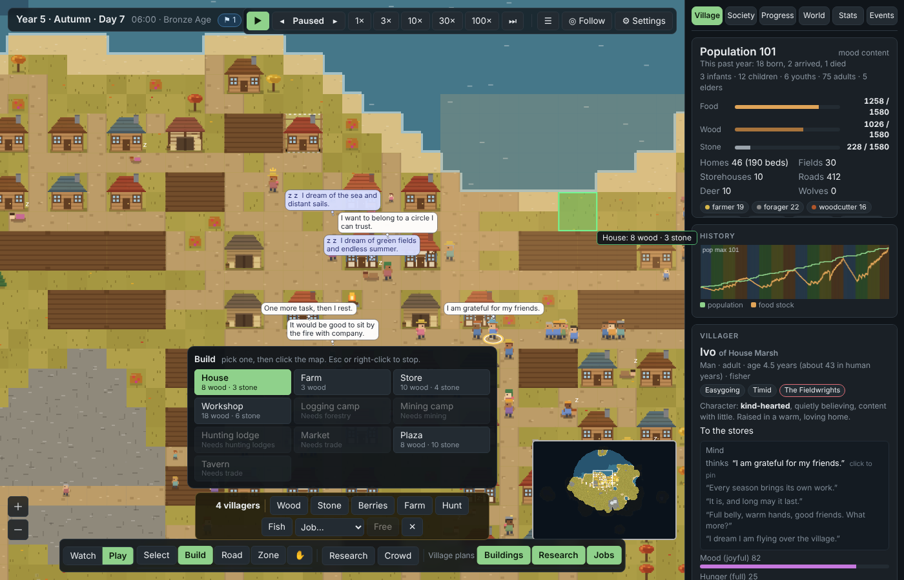

### v0.34.1 — Faster and launch-ready
Faster and launch-ready. The game is the same as v0.34; this release is about how fast it is tested and how it is presented. **Faster tests:** a new tool, `tools/checkpoint.js`, saves a world at a chosen day (`tests/checkpoints/`, 50 to 130 KB each) and eight slow suites (performance, discovery, outposts, lives, living, privacy, war, culture) now load one instead of simulating the early game. A reload always continues the same way, but not exactly like a straight run (villagers come back idle), so checkpoints serve as fixed starting points and the golden, save and performance suites still run from scratch. The wolf scan is an exact speedup (the golden trajectories are unchanged). The full run is **13 minutes 26 seconds, down from 16 minutes 58**. **Launch prep:** the README is now a short front page with a time-lapse of a village growing, a gallery and a release history, with the long feature notes moved to `docs/FEATURES.md` and the architecture notes to `docs/ARCHITECTURE.md`; an MIT license; `tools/make-gif.js` rebuilds the time-lapse. The project moved to a new repository named village-sim.

### v0.34 — Crowds
Crowds. A growing town no longer slows to a crawl. The 160 people with the most story (partners, children, a role, a hobby, a long life) stay **in play**, simulated one by one; everyone else is **the crowd**, kept as numbers by age: born, growing up, working the fields, woods and quarry, eating, falling sick and dying, drawn as small figures at the houses, and called forward as named villagers (or sent back) as the town changes. The population reads like **87 (37 in play)** and the age breakdown counts everyone. Measured on a forced crowd of 2,800 people: about 1.1 ms per tick and a 650 KB save. Housing now follows crowding: the Not enough homes concern is answered when a quarter of the adults share rooms against their sociability, a house is built, crowded families move into empty homes, and the farm limit rises with the population, so building is smoother. Checked that nobody vanishes: births plus arrivals minus deaths and leavers matches the population exactly, and groups founding outposts are counted. The test runner gained a resume mode that reruns only what is not yet green.

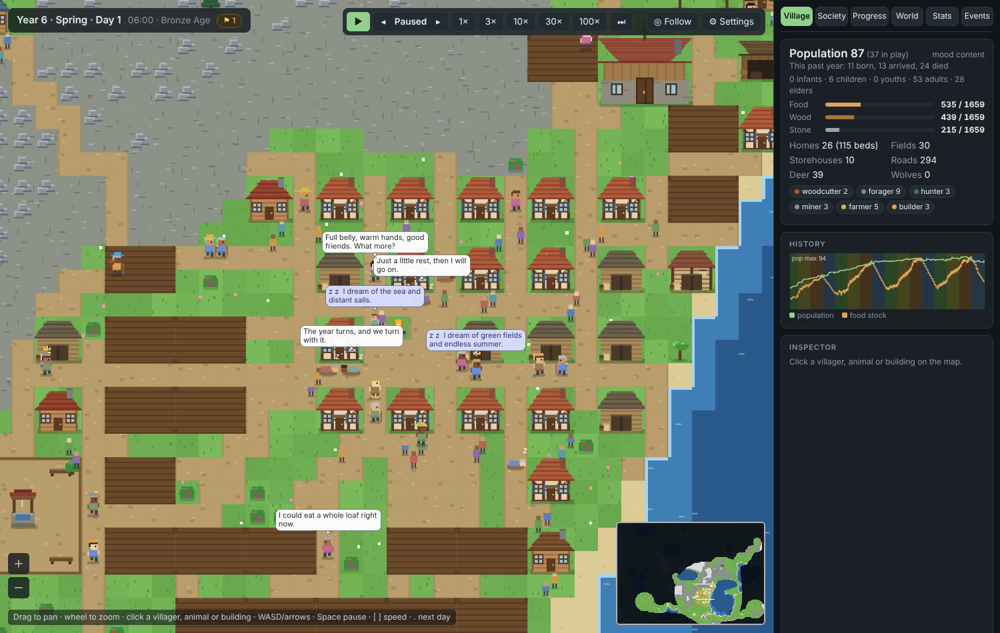

### v0.33 — City structure
City structure. The village now grows into a town in a shaped way. Every 4x4 tiles gets a **land value** from the pull of the camp, market, plaza, tavern and other services, roads and the shore, minus the nuisance of fields, camps and forges; the new City card in the World tab shows the layout, the mix of home styles and a **land value map** button. The dearest ground gets the best style the village knows, the edge keeps log cabins, old homes are rebuilt in place, ruins are cleared and fields the town has grown around are given up. **Hamlets** (named by direction) are founded when the close ground fills up; they get their own store. Villagers' footsteps pave **desire paths**, and busy roads get better surfaces first. A new **workshop** building gathers the crafts. When beds run short the Housing concern now says what is in the way. Settings shows a one-line **world line** (click to copy, or paste a whole line into the Seed box) with a collapsed Diagnostics snapshot and a saved log of your own choices. The Concerns list keeps its scroll position at fast speeds.

### v0.32 — Settlements, causes of death and housing
Settlements, causes of death and housing. Click another settlement on the map (or its name in the World tab) for a full panel: people, temper, strength, treaty and dealings, what each side knows that the other does not, origin and history. A new **Causes of death** card in the Society tab shows totals by cause, this year against last year, age groups, the main preventable cause with advice and recent deaths. When the ground near the village is full, new homes are now sited further out (suburbs and hamlets) and the Housing concern says so. Fixes: the tree of knowledge window fits the stage on small screens, 'Recently eased' stays open, culture no longer saturates, plague is a little likelier. Tests: `tests/ui_settle.js` and `tests/housing_events.js`.

### v0.31 — Society depth
Society depth. A **culture** score grows from weddings, funerals and winter story nights (and slowly fades unless kept up); culture, curious minds and a library add a little to research. With **Disasters** on, spring floods and a **plague** can strike; the council chooses between quarantine and carrying on. With coinage, five or more in one trade found a **guild** that pays dues into the treasury. Outposts of eight or more get a **council head** of their own. The council can sell lessons to a friendly neighbour, hostile neighbours send **spies** who may steal a craft (the law and watch catch some), and the council may spy on a rival. Authority is re-tuned so crises push it up less and culture pulls it down a little. New 'Culture & guilds' card in the Society tab, statistics, chronicle entries and a plague concern. Tests: `tests/culture_events.js` (28 checks) and `tests/ui_culture.js`.

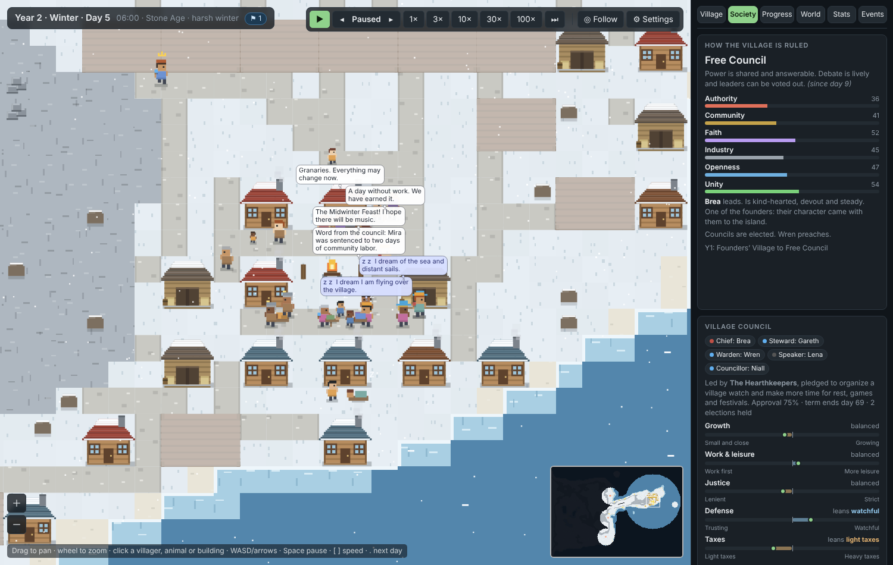

### v0.30 — Conflict
Conflict arrives, abstractly. With the **Raids and war** switch on (off by default; peace is still the default and the simulation is unchanged without it), a hostile neighbour the village has met makes the council muster a watch of real villagers, up to a target that grows with the danger, the defence policy and the regime. Arms follow technology (militia, spearmen, archers, swordsmen, legionaries, musketeers); soldiers wear a helmet and carry a spear on the map. A **Barracks** drills the ranks and a **Watchtower** gives early warning; both are new great projects with their own art. Upkeep comes out of the food store (cheaper under authority) and morale rises and falls with food, victories and defeats.

Battles are abstract (two sides, three rounds, casualties on both) and settle raids on the village (friends with a treaty may stand with it), attacks on outposts (which may be driven off, hurt or overrun) and the council's own campaigns: after enough raids or a grudge, the council is asked whether to march on the neighbour, send envoys with gifts, or hold. A campaign takes days, the soldiers are away and do not defend meanwhile; victory brings plunder and a spell of tribute, defeat costs lives and respect. New concerns ("poorly defended", "army going hungry"), statistics, chronicle entries and a **Defence & war** card in the World tab.

Also fixes an old bug: victims of raids and strife were given 0 health but regained a little before the death check, so many of those deaths never happened. Tests: `tests/war_events.js` (51 checks) and the page test `tests/ui_war.js`. Control of the army (orders, stance) is planned for v0.33.

### v0.29.2 — Varied bubbles and quicker tests
Villagers' thoughts no longer repeat across a crowd: every thought carries other wordings for the same subject (about 35 new lines for hunger, tiredness, loneliness, cold, contentment, low spirits, housing, privacy, drought, winter and the seasons), a bubble picks a wording that has not been on screen in the last 90 seconds, and no more than two bubbles on the same subject show at once. The small white emote box over a villager now shows only for the selected villager (alarms still show for all). The simulation is identical to v0.29. Tests: the full run is about 17 minutes (was 22), the wolf check and the performance gate are shorter.

### v0.29.1 — Test suite overhaul
Tools only; the game is identical to v0.29. The tests now run two at a time and print each result as it finishes, with a timing table. `tools/check.sh` runs only the suites the changed files can affect, `full` runs all 24 (about 22 minutes instead of 28 to 45), and `pages` runs the browser page tests. One loader builds the source list from the script tags in `index.html`. New golden-trajectory tests (six map types, 30 days each) and a performance gate (10 years, fail above 1.5 ms per tick) join the suites. A full green run is stamped with a hash of the code, and `tools/release.sh` now refuses to release unless that stamp matches the exact code being released, so a failing or untested build cannot go out. Old debug and screenshot scripts moved to `tests/legacy/`.

### v0.29 — Voices and thoughts
Villagers now think, dream and talk. About thirty kinds of thought come from their real state (hunger, mood, work, family, grief, a coming baby, the winter stores, festivals, discoveries, expeditions and new material finds, rumours, plans, quarrels, money, old age); sleepers dream; two villagers who stop to chat speak and answer, and a pair who dislike each other speak coldly. Bubbles scale with speed: full lines at 1&times; and below (six at a time), a few words at 3&times;, a single glyph at 10&times; and 30&times; (three at a time, nearest the middle of the screen), none at 100&times;. Click a bubble to select the villager and pin the line; the inspector has a **Mind** block, and the Events tab has **Talk of the village**: a live feed at slow speeds, daily summaries at all speeds. Claude-written lines are an optional toggle, off by default. Thoughts use no random numbers, so the village runs exactly as before. Also: the Food readout no longer shows long decimals.

### v0.28.1 — Scarcer materials, new discoveries and a world check
Materials are now rare: each map holds one deposit per material (saltpetre, coal, copper, oil), and a party only recognises it once the village knows the matching craft (masonry, mining, bronze, steam); until then it brings home "strange stone nobody can name yet". Neighbours sell a material only when relations are friendly. New places appear over time: diving bells reveal deep wrecks, sonar the sea bed, aviation a lost city, and a deep drought can uncover a hoard in the shrunken waters. The new-world dialog gets a **Check this world** button that lists a map's special features (land share, fishing, stone, neighbours, whether barges can serve a land neighbour, hidden places and deposits). A yearly population-flow line in the probe (births, deaths by cause, arrivals, outpost population) is there to track the year 7&ndash;14 dips. On island seed 12 coal now arrives at year 9 and saltpetre at year 10 (v0.28: copper and oil by year 2&ndash;4).

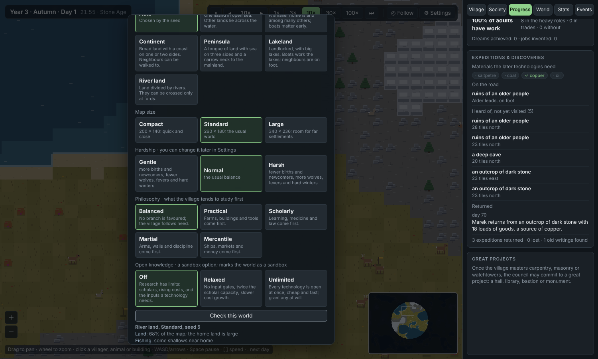

### v0.28 — Expeditions, discovery and a living sea
Every map hides about 23 places worth a journey (ruins of an older people, caves, outcrops, hoards, wrecks, fishing and whaling grounds) plus the village's own past (a trading ship it lost, an outpost that died out). Rumours reveal them; the council weighs expeditions and sends a leader, with a few escorts on land or a boat at sea; they come home with goods, old writings (even a forgotten technology), food or a source of **saltpetre, coal, copper or oil**, the new inputs that gate gunpowder, steam, steel, electricity, engines and aviation. Fish recover faster where the water is full, deer winter in sheltered pockets and return in spring, river barges carry bulk goods to neighbours reached by water, friendly neighbours sell lessons for coins, and a discovery now says what it opens. New statistics series and an Expeditions &amp; discoveries card.

### v0.27 — Unlocks, research limits and a shaped land
Every technology now says what it gives and what it needs (a coast, rock, a mine, a library, enough people); research has limits (scholar capacity, rising costs, missing inputs), so a typical civilization finishes about 60&ndash;70% of the tree; the council's circles and a chosen philosophy steer the agenda; an Open knowledge sandbox option and a Grant button; a clickable tree of knowledge; terraforming works (levelled ground, drained shore, terraces, dikes, polders, earthworks); tower blocks; outposts with their own temper.

### v0.26 — Growth and housing
Births, pairing and newcomers now follow how well life is going; a Hardship setting (Gentle, Normal, Harsh) at world creation and live; builders plan ahead; health technology lengthens life; people have a wish for privacy (private houses, cabins in the trees, crowding and outdoor sleeping matter); a Housing concern with a Building drive. Six-seed comparison: population at year 12 went from 90 to 141.

### v0.25 — Livelihoods
About 35 trades (odd jobs, crafts, services) with real demand, goods and prices; side jobs, villager-invented jobs that catch on or fail, overtime by regime, aspirations, and craftspeople with aprons, tools and workbenches.

### v0.24.2a — Concern tracker
Concern cards now show a state (needs attention, responding, easing, didn't work), a severity bar with trend, countdown bars for running responses, council decisions, and resolved concerns stay for a while.

### v0.24.1 — Concerns
A badge, panel and toasts warn of falling population, food and firewood shortage and unity trouble, with feasts, rationing, orders and council nudges; secessions made rarer and smaller.

### v0.24 — Technology and ages
109 technologies in 8 branches across 9 ages, six house styles, four road tiers, knowledge that can be lost.

### v0.23 — Statistics and insight
A Stats tab with charts, event rates, records and CSV/JSON export, plus a multi-seed insight report.

### v0.22 — Lives and society depth
Hobbies, property, inheritance, feuds, policy that follows the regime, new time controls.

### v0.21 — Settlements and expansion
Outposts from camps to towns, bridges, and a new-world dialog with map size.

### v0.20 — Maritime and river commerce
Trade routes, harbour tiers, cargo ships and a ledger.

<b>Earlier versions</b>

### v0.19 — Map types
Archipelago, continent, peninsula, lakeland and river land, with neighbours on foot.

### v0.18 — Movement and population
Smoother paths, personal space, reserved spots, human-year ages, population flow.

### v0.17 — A living world
Trees that mature, soil that tires, wet and dry years, wolves that return, sightseers.

### v0.16 — Inspector overhaul
Building usage and popularity, residents, family links.

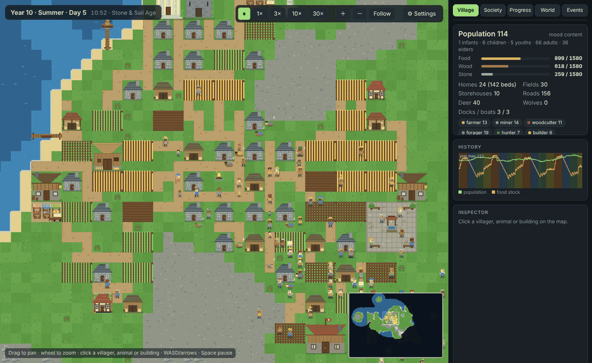

### v0.15 — Divided villages
Rival councils, strikes, civil strife, secession and sects.

### v0.14 — Divergent societies
Character, upbringing and regimes: no two villages turn out alike.

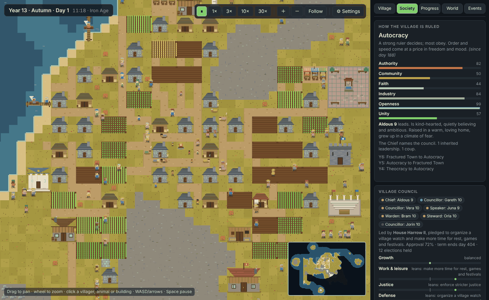

### v0.13 — Tabbed side panel
Village, Society, Progress, World and Events tabs, faster fog, packed saves, a seed-sweep harness.

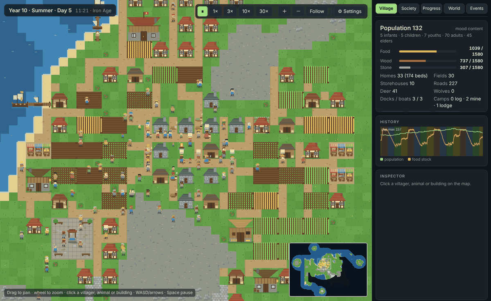

### v0.12 — Building stats
Hit points, wear and repairs shown in the inspector.

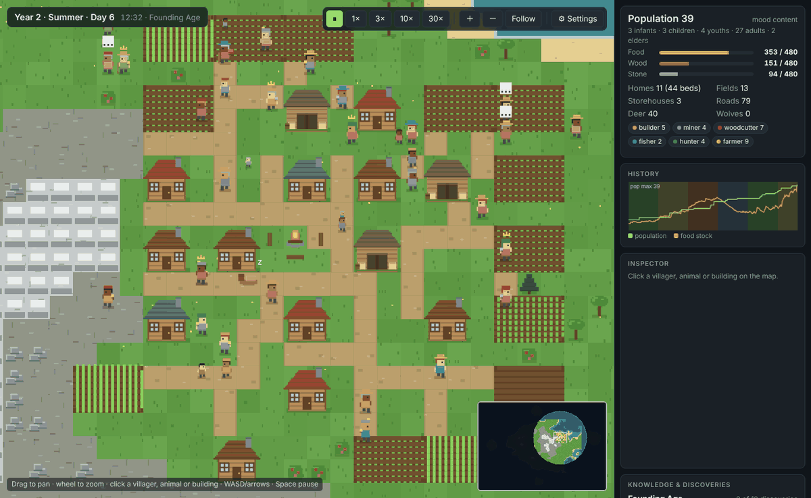

### v0.11 — Diplomacy and trade with neighbours
Relations, treaties, visits, aid, tribute and raids with scholars, farmers, merchants and raiders.

### v0.10 — The wider sea
A 260×180 world with neighbouring islands under fog of war, found by sailors.

### v0.9.1 — Gathering places
A plaza and a tavern: villagers gather for evenings, sessions and holidays.

### v0.9 — Time travel and more projects
Fast-forward a year at a time, with a progress bar, and more great works.

### v0.8 — Factions and history
Circles turn into factions; a chronicle and lessons the village learns from famine, fire and fever.

### v0.7 — Great projects
Temples, granary halls and other monuments the council can choose to build.

### v0.6 — Trade, money and taxes
Markets, coins, taxes and a settings drawer.

### v0.5 — Technology, boats and camps
A technology tree that changes buildings, docks and fishing boats, resource camps, a diagnostics panel.

### v0.4 — Saving
Autosave, export and import of save files, resume prompt.

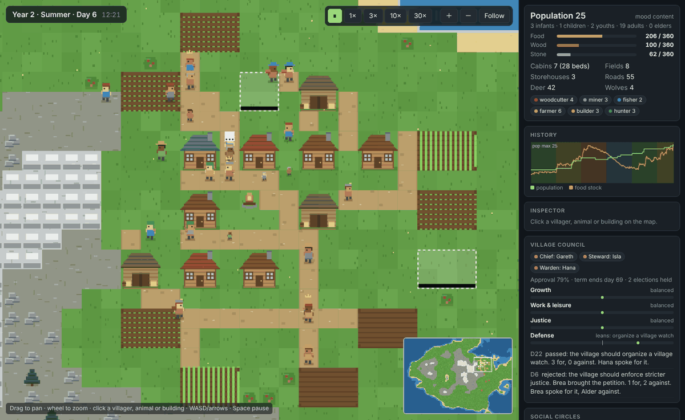

### v0.3 — Lives, opinions and a council
Life stages from infant to elder, personal desires and stories, opinions on four issues, friendship circles and an elected council.

### v0.2 — First playable village
A 160×112 island with four seasons, deer, fish and berries; villagers with five personality traits who decide by priority (danger, hunger, sleep, company, work); optional Claude narration.

