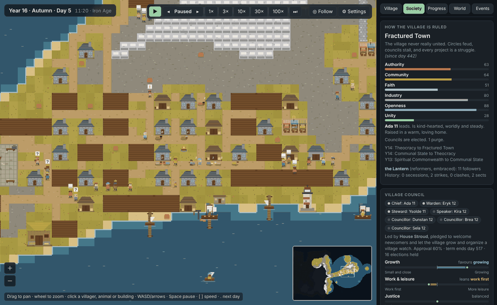
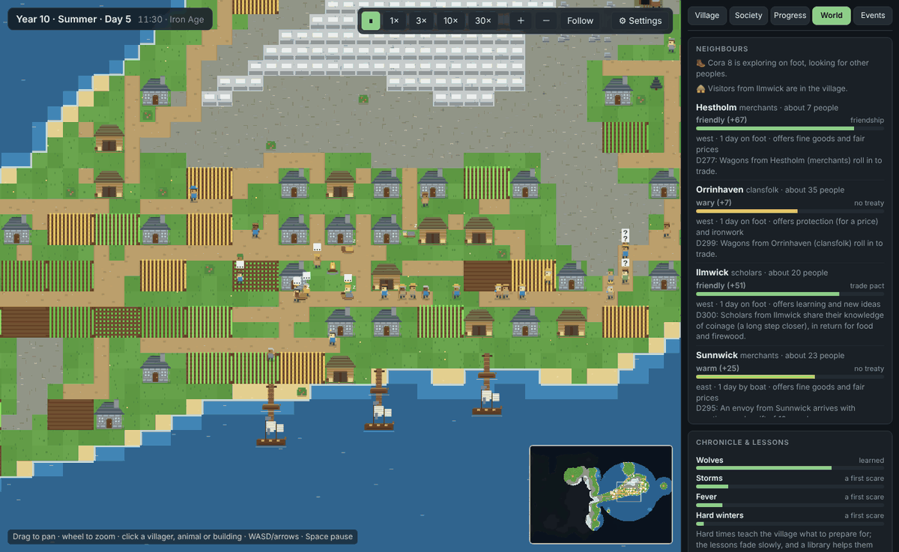

<h1 align="center">Village Sim</h1>

<b>A watch-mostly village that grows into a civilization.</b> Pixel art drawn in code, a deterministic seeded simulation, plain script tags: no build step, no dependencies. v0.25 · <a href="CHANGELOG.md">Changelog</a> · open <code>index.html</code> to play

<table>
<tr>
<td width="50%"> <b>Concerns:</b> the village warns you when people, food or unity are in trouble, and you can respond.</td>
<td width="50%"> <b>Statistics:</b> charts, event rates and records for everything that happens.</td>
</tr>
<tr>
<td width="50%"> <b>Society:</b> regimes, councils, feuds and policy that emerge from the people.</td>
<td width="50%"> <b>Worlds:</b> islands, continents, lakes and rivers, with neighbours across the water.</td>
</tr>
</table>

A watch-mostly village simulation: a 160×112 island you can pan and zoom, four seasons, wildlife, villagers with personalities and roles, and a town that plans and builds itself.

## Run it
Open `index.html` in a browser. There is no build step and no dependencies (plain script tags, so it also works from `file://`).

The optional **Claude counsel** (right panel) only works on the published page, where the page can call Claude. It is **off by default**. When on, the council and courts hand Claude a short list of concrete options (pass or reject a motion, pick a remedy for a crime wave, choose a sentence). Claude picks one based on each member's personality, opinions and what worked before, and writes the debate. The choice is validated; if it is off, slow or invalid, the village's own rules decide. Limited to 40 deliberations per session.

## Technology, eras and building
- **Knowledge** comes from debating, practising a trade and teaching. The council chooses what to study next (rules by default; Claude can deliberate). 15 discoveries across four ages: Founding, Craft, Stone & Sail, Iron.
- **Effects:** bigger catches (nets), faster work (tools, ironwork), more storage and less spoilage (granaries), higher crop yields (rotation, plow), safer winters (medicine, watchtowers), and more.
- **Architecture changes with the ages:** log cabins, then timber-frame houses (carpentry), then stone houses (masonry). Roads become cobbled. Old homes are upgraded over time, and better homes sleep more people. Storehouses change style too.
- **Docks and boats** (boat-building): fishing boats sail straight out from a dock to deep water, fish, and return; catches are unloaded at the dock.
- **Camps** (forestry, mining, hunting lodges): a camp beside dense forest, rock or game acts as a local depot. Workers within about 14 tiles (22 for hunters) work faster, get more per trip, and hunts are surer.

## Trade, money and taxes (new in 0.6)
- **Trade** research lets the council build a **market** (stalls, a coin sign, a merchant wagon on caravan days). Prices rise with scarcity of wood, stone and food. Caravans arrive every 5–9 days; with **Sea trade** and a dock, trading ships come too. The council (or Claude counsel, if on) decides how much to sell or buy.
- Before **Coinage** trades are barter; after it, the village keeps a **treasury** funded by a tax whose rate follows the Taxes policy (10–40%), and villagers earn, save and buy fine goods that lift mood. Wealth feeds opinions on taxes and can drive crime. See the Trade & treasury card.

## Livelihoods: everyone finds a way to make a living (new in 0.25)
Beyond the six heavy roles there are now about 35 trades: odd jobs and care from the very start (childminder, helper, porter, water carrier, mender, kitchen gardener, launderer), crafts unlocked by technology (potter, weaver, tailor, smith, carpenter, baker, brewer, jeweller, glassblower ...) and services (healer, midwife, teacher, scribe, scholar, innkeeper, musician, watchman, shopkeeper, merchant, banker ...). Each has real **demand** for the village's size and needs, a price and a small real effect: tools speed up work, cloth keeps people warm, pots and fine goods bring comfort, bread feeds, healers heal, teachers teach, musicians and innkeepers cheer, watchmen keep wolves away. A market full of a good wants no more of it.

- **Money:** crafts create value, services move coins (or barter wealth before coinage) from customers to workers. Customers can only pay what they hold, so a poor village supports few trades.
- **Finding work:** adults without a role take a trade where demand is unmet; people with a role take side jobs when short of cash or out of work in winter; a richer village lets some people leave heavy labour for a trade. Oversupplied trades shed workers.
- **Invented jobs:** idle, curious people try ideas (lantern maker, dyer, honey keeper, rat catcher, bone carver ...). Each has a hidden market: some catch on and become trades, others fail and their maker moves on a little wiser.
- **Overtime:** when food or firewood runs short, a free council gets volunteers working longer hours; a strict one orders it, at a cost to mood, health and unity.
- **Dreams:** adults aspire to a shop of their own, mastery of their craft, scholarship, a council seat, a large family, a fortune or a sea voyage, and pursue it when life is comfortable. Shown in the villager panel and the chronicle.
- **On screen:** craftspeople wear an apron colour for their trade, carry a small tool at work and stand at a little workbench. The Progress tab has a Livelihoods card; the villager panel shows livelihood and dream.
- Tests: `tests/livelihoods_events.js` (22). New scripts: `tools/check.sh quick|full`, `tools/probe_liv.js SEED MAP DAYS`.

## Concerns now track what you did about them (0.24.2a)
Each concern card shows a state: **Needs your attention**, **Responding** (a countdown bar for each running response, "council deciding" for nudges), **Easing**, or **Didn't work** (a response ended or was declined and the trouble remains). A severity bar with a worsening/steady/easing arrow shows how bad it is. Resolved concerns stay visible for 16 days with what was tried. The badge turns calm blue when everything is being handled.

## Concerns: the village watches itself (0.24.1)
- **What it watches:** population (a fast fall, or a long slide from the recent peak, with the cause: deaths by kind, births, people who left with a faction), food (stock per person, starvation), firewood before winter, and unity (a divided village, a rival council, civil strife, outposts losing loyalty). Each concern is *watch* or *critical*, has a plain reason, and clears by itself when the trouble passes.
- **Where you see it:** a **⚑ badge** in the date bar (amber, red and pulsing when something is critical) opens a **Concerns panel** with the reason, how long it has lasted and the responses you can try. Critical concerns also raise a **toast** that stays until you dismiss it or the trouble passes (at most three). Settings &rarr; Concern alerts chooses what a new critical concern does to the game: nothing extra (default), **pause**, or **slow to 1×**; toasts can be switched off.
- **Responses (each has a cost, a cooldown and an effect you can see):** *Hold a feast* (spends food and firewood, lifts mood and unity), *Ration food* (16 days: slower hunger, shorter tempers), *More hands on food* and *More hands on firewood* (more farmers, hunters, fishers or woodcutters), *All hands* (10 days, no leisure, costs mood), and four **council nudges** (encourage families, less leisure, ease the laws, open reconciliation talks): the council still decides whether to heed you, and is more likely to when it is not an autocracy.
- **Secession is rarer and smaller:** a faction may break away at most once in about four years, takes at most 30% of the adults (the most aggrieved), and the village feels relief afterwards. Coup and purge penalties to unity now fade over 60 days instead of lasting while they recur, and purges need 50 days between them.
- **Why:** in long runs the big population drops were whole factions sailing off (29&ndash;37 people each, five times in 45 years on one continent world), kept coming by permanently low unity.
- **Tools:** `tests/concerns_events.js` (in the release checks), `tests/concerns_ui.js` (page test with screenshots), `tools/diag.js SEED MAP DAYS` (year-by-year health record: births, deaths, departures, resources, roles, stuck villagers, speed), `tools/probe_div.js` (which parts of the unity formula dominate), `tools/probe_social.js`.
- **Next:** v0.24.2 Livelihoods (trades, side jobs, overtime, invented jobs, aspirations), because in big towns 40&ndash;55% of adults have no job role.

## Technology and ages (new in 0.24)
- **A tree of 109 technologies in 8 branches** (Land & food, Building, Craft & metal, Sea & trade, Learning & faith, Society & law, War & defence, Medicine) and **9 ages**: Stone, Bronze, Iron, Classical, Medieval, Renaissance, Gunpowder, Industrial and Modern. The original 18 technologies keep their names and ids, so old saves load.
- **Ages:** an age is complete when 65% of its technologies are known; then the next age's technologies open (each still needs its own prerequisites, often from other branches, so no village can race ahead by studying one subject). The age shows in the date bar and in the Progress tab, which has a branch list (click a branch to see every technology, what it needs and what it costs).
- **Effects:** newer technologies add to farm yields, work speed, building speed, knowledge growth, health, storage, trade, sea power, defence and contentment, on top of the original technologies' special effects. Houses and storehouses now go through six styles (log cabin, timber frame, stone, **brick house, townhouse, apartment block**), with new art, and roads go from dirt to cobbles to paving slabs to tarmac.
- **Choosing what to study:** the council picks from the six most useful open technologies; a balanced village is nudged toward the branches it has explored least; the ruling circle, the council members' tastes and past lessons still count.
- **Neighbours learn too:** scholars, merchants, farmers and clansfolk advance at different paces and in their own branches, and visiting scholars can teach the village what it is ready for.
- **Knowledge can be lost:** when the population collapses to under about 45% of its peak, the newest, least-shared skills can be forgotten and must be learned again (counted in the statistics).
- **Ladders for later steps:** terraforming (8 technologies from "Levelling plots" to "Heavy earthmoving"), exploration (11, from "Sky-watching" to "Sonar") and war (7) are marked in the tree.
- **Tools:** `tests/tech_events.js` (in the release checks), `tests/shot25.js`, `tools/pace.js SEED MAP DAYS` (when each age began, techs per decade, speed).

## Statistics and insight (new in 0.23)
- **Stats tab:** "A civilization in numbers" (age, population and peak, births and deaths, technologies, great works, peoples known, outposts, unrest) and an **Over time** chart. Pick a view (People, Wealth & mood, Regime, Policy, Growth) or add any of 38 measures (up to five), choose the last 5 years, 20 years or everything, and hover for exact values. Each line is scaled to its own range. Triangles along the bottom mark notable events (red for hard times such as coups, famines, fevers, strikes and secessions; green for outposts, bridges, great works and discoveries); dashed lines mark new ages.
- **What happens, and how often:** about 50 kinds of event grouped as People (births, newcomers, couples, deaths by cause), Hardship (fires, storms, droughts, harsh winters, fevers, wolf attacks, famines, collapses, lost cargoes), Society (elections, council decisions, coups, uprisings, purges, reforms, rival councils, strikes, civil strife, secessions, sects, crimes, trials, feuds, estates, holidays), Economy & expansion (deals, trips, ships, harbours, peoples discovered, outposts, bridges) and Knowledge (discoveries, ages, great works, lessons). Each row shows the total, the rate per year over the last five years, a trend arrow against the five years before, and a yearly sparkline.
- **Records & firsts:** largest and smallest population, most unequal, most united and divided, happiest and gloomiest, busiest years, and the day each kind of event first happened.
- **Export:** CSV (every series, then every event by year) or JSON (summary plus all raw data) from the Stats tab. The data is saved with the world and kept for the whole run (thinned automatically after about 2,400 samples).
- **Insight report:** `node tools/insight.js [days] [concurrency] [seeds per map]` runs many worlds across every map type and writes `insight-report.md`: results by map type and by final regime, the strongest correlations between features, and specific questions (does early inequality predict later unrest? does trade go with growth? does authority go with unrest?). Small samples give hints, not proof.
- **Tools:** `tests/stats_events.js` (in the release checks), `tests/shot24.js`, `tools/insight.js`, `tools/insight_one.js`.

## Lives, property and feuds (new in 0.22)
- **Hobbies and errands:** every adult has a hobby (angling, wood-carving, gardening, stargazing, singing, storytelling or long walks) chosen from their character. After work, adults may pursue it or run an errand: visiting kin, taking a meal to a hungry relative, fetching water at the well. Hobbies lift mood and sometimes give a little food, knowledge, keepsakes or friendship. The more leisure the council's work-and-leisure policy allows, the more of this the village does (and the slower the work).
- **Property:** homes and fields have owners (the first adult to settle a home or work a field). Field owners keep a share of the harvest as wealth (none in communal regimes). A villager's **standing** (overlooked to prominent) mixes wealth, reputation, office, property and family; it shows in the inspector and nudges mood and elections.
- **Inheritance:** when an owner dies, the partner, a favoured or eldest child, or a sibling inherits homes, fields and wealth; with no heir the estate goes to the village. Someone passed over may feel bitter and start a feud.
- **Feuds:** families fall out after a brawl, a disputed will, or an old grudge. Kin on both sides grow colder every day, fights become likely, and moods suffer. A hot feud goes to the council (mediate, side with one family, or stay out). Time, festivals, mediation and marriages across the divide cool it. The losing side of a feud is the first to feel aggrieved when a village starts to divide (rival councils, strikes).
- **Policy and power:** policies now drift toward what the regime favours (an autocracy turns strict and watchful, a commune turns to heavy taxes and light law, an industrial town to work first and growth); council votes still move them. The council card has a **Who holds power** bar (chief, council, ruling circle, wealthy families, faith, the people). The Society tab has a **Families & feuds** card.
- **Performance guard:** path searches are limited per tick (150,000 nodes); a villager whose search is refused simply waits a moment. Daily planning is not limited.
- **Tools:** `tests/lives_events.js`, `tests/shot21.js`.

## Settlements, bridges and bigger worlds (new in 0.21)
- **Outposts:** when the village feels cramped, short of timber, stone or food, or simply grows large and bold, the council can send settlers to found an **outpost**: a logging outpost, quarry, fishing station or farming hamlet. It weighs gain against cost and risk (settlers, supplies, a journey that can fail) with the same rule as trade; bold, open villages expand, wary or communal ones seldom do.
- **Life of an outpost:** the party walks (or sails, if the village has boats and a dock) along a route you can see; the outpost feeds itself, grows from a **camp** to a **hamlet**, **village** and **town**, and every few days sends a share of what it makes home by cart or ship (some loads are lost on the way). Click it on the map or in World &rarr; Settlements to see people, loyalty, share sent and founders.
- **Loyalty:** it falls with a heavy share, distance, hunger and a bigger, prouder outpost, and rises with help. A restless outpost asks the council to send aid, lighten its share, or be left alone. An outpost that stays resentful **breaks away** and becomes a neighbour of its own (friendly or bitter).
- **Bridges:** with carpentry (timber) or masonry (stone), the council can span a strait or river up to five tiles wide, tile by tile from our own bank, when the walking saved or land opened is worth the cost, and never where it would cut a dock off from the sea. Bridges are walkable by people and animals and saved with the world.
- **New world dialog:** Settings &rarr; New world&hellip; picks the seed (with dice), map type, and **map size**: Compact (200&times;140), Standard (260&times;180) or Large (340&times;236). Island and archipelago worlds always use at least Standard (they need open sea).
- **Tools:** `tests/outposts.js`, `tests/bridges.js`, `tests/sizes.js [days]` (every map type at every size), `tests/newworld.js` and `tests/shot20.js` (browser), `tests/pl4.js` (profile a slow world in the page).
- **Not yet:** outposts do not build individual houses or have their own council; settlements are records, not a second simulation. Neighbours on large maps are still few.

## Harbour and trade abroad (new in 0.20)
The village no longer waits for merchants. It now trades for itself.
- **Trade trips:** with trade and sea trade (or on foot for land neighbours), the council looks at every neighbour it knows and weighs the best trip with one shared **cost-benefit rule**: what the cargo should earn, against crew time, ship upkeep and the risk of losing it. The council then decides whether to **send** the trip, make it a **standing route** that repeats while it keeps paying, or **wait**. Claude can counsel these decisions as with others.
- **Cargo:** goods leave the stores, are carried by a ship or wagon, sold at the neighbour's prices (each kind of neighbour pays differently and friendlier ones pay better), and what the village is short of comes home. Trips are skippered by a real villager, can be lost to bad weather, and the skipper may be lost too (with the Disasters setting on).
- **Ships:** fishing boats can carry a small load (24); **cargo ships** carry 70; **carracks** carry 140 and sail faster.
- **Harbour tiers:** a **dock** can be improved to a **quay** (stone landing, warehouse, more berths, cargo ships) and then a **port** (cranes, customs sheds, carracks, customs revenue on every trip). The council weighs each improvement against its cost.
- **Regimes matter:** open, merchant-minded villages trade eagerly; devout or hard-ruled ones seldom; communal ones put all the profit in the treasury.
- **See it:** the Progress tab has a Harbour & trade abroad card (tier, fleet, current trip, standing routes, ledger, recent trips); the dock panel shows tier and berths; cargo ships and port cranes have their own art.
- **Council policies** now show a clear two-ended bar with plain words ("favours more leisure", "strongly watchful").
- **Population line** is a quiet sentence: "This past year: 10 born, 3 arrived, 2 died".
- **Tools:** `tests/routes.js`, `tests/shot19.js`.

## Map types (new in 0.19)
New worlds now come in six map types, chosen in Settings (or **Auto**, picked by the seed):
- **Island:** one island in open sea, other islands beyond (the original map).
- **Archipelago:** a smaller home island among several others; boats matter early.
- **Continent:** land across the whole 260x180 map with a coast on one or two sides and mountains along the rest.
- **Peninsula:** a tongue of land with sea on three sides and a narrow neck to the mainland.
- **Lakeland:** landlocked with big lakes; boats work the lakes.
- **River land:** one or two winding rivers divide the land; they can be crossed only at **fords** (a new walkable shallow terrain).
- **Neighbours on foot:** on the land maps, other peoples live a few days' walk away. Hunters and curious villagers go exploring to find them; they trade by wagon, send envoys, migrants and aid on foot, and can raid by land. Coastal maps also have an island or two reached by boat.
- **Starts that work:** the village starts on the biggest connected land, with a shore fishers can actually walk to. If the only shore lies behind thick woods, fishers cut a way through when food runs short.
- **Old saves** load as the original island map. New islands now also fade out toward the edge of the home area instead of being cut off.
- **Not yet:** wildlife migration between regions. (Bridges arrived in 0.21.)
- **Tools:** `tests/maps.js [seeds] [show]` (ASCII previews and checks), `tests/mapsweep.js` (a short sweep for each map type), `tests/shot17.js` (overview images).

## Movement and population (new in 0.18)
- **Natural movement:** paths are smoothed into straight diagonal shortcuts (never leaving roads, never cutting through brush or odd ground, and keeping clear of walls). If something is built across a shortcut, the walker plans again. Trips are a few percent shorter, so villages are a little more productive.
- **Personal space:** villagers who stand or walk close together are eased apart when drawn, and standing spots at the square, tavern and hall are reserved so people don't stack on one spot. A small hop animates walking.
- **Ages in human years:** a villager's age shows in game years with a human-years equivalent in brackets (display only).
- **Where the population changes come from:** the Population card shows the past year's births, arrivals (travelers and boat migrants), deaths and departures (banished or sailed away).
- **Secret key 5:** runs the simulation as fast as the machine allows (about 270x here), for testing. Keys 1 to 4 return to normal speeds.
- **Measured:** pathfinding is only about 8% of run time, so no path-engine rewrite was needed yet; terrain-cost paths and connectivity come with the map step, and crowd movement with military units.
- **Tools:** `tests/move.js` (walls and trip length, smoothing on versus off).

## A more living world (new in 0.17)
- **Sightseers:** villagers walk over to look at the Monument, Temple (devout villagers pray there), Library (curious ones browse), Lighthouse, Bastion, Citadel, Foundry and Great Granary. Visits are counted in each building's panel, with popularity trends.
- **Output statistics:** logging and mining camps, farms and docks track what they produce: this season, last season, past year, all time, with a trend and a small four-season chart.
- **Trees:** new trees start as saplings and take about 12 days of growing weather to mature. Woodcutters only fell mature trees, and partly cut trees grow back.
- **Soil:** every field has a fertility that falls with each harvest and recovers over time (faster when left bare in winter; rotation halves the wear). Tired soil gives smaller harvests.
- **Weather years:** each spring brings a wet, dry or ordinary year that raises or lowers crop growth.
- **Animals:** wolf packs return to where there is deer and can breed (capped); berry bushes regrow more slowly.
- **Tools:** `tools/release.sh` (tests, zip, repo sync, commit, push), `node tests/sweep.js quick` (6 worlds x 192 days), `tests/living.js`.

## Inspector overhaul (new in 0.16)
- **Buildings:** fixed the age bugs (day-0 buildings always read 0 days; upgrades overwrote the original era). Panels now have Usage, People and Details sections. Venues (square, tavern, hall, amphitheatre, market, campfire, docks) track visits this season, last season, the past year, all time, a popularity trend (growing, steady, fading) with a small four-season chart, and regulars. Houses list residents; camps list workers; docks list boats and total catch; great works say who built them.
- **Villagers:** age in years, family (partner, parents, children), housemates, places they are often found at, work output, birth date. Names are links: click one to jump to that villager or building.
- **Animals:** health, hunger, age, activity, pack size for wolves.

## When a village divides (new in 0.15)
Unity is no longer just a number. A circle that feels unheard, is unhappy, or sits far from the way things are run can now act, and the council has to answer (or Claude can counsel it, if you have that switched on).
- **Rival councils:** an aggrieved circle sets up its own council under its most charismatic member. The council can **seat** them (and shift policy toward their grievance), **ignore** them, or **seize** the leader. A divided council stalls its meetings.
- **Strikes:** a circle can put down its tools over one policy. The council can **concede**, **hold out**, or **break** the strike. Strikers really stop working and gather at the square.
- **Civil strife:** a long standoff, low unity and the violence setting can lead to street fighting with wounded and dead (it follows the *Crime* setting). It ends in one side holding the village, the rebels taking power, or a stalemate.
- **Secession:** when fighting or a standoff cannot be mended, the council can **let a circle go** or forbid it. The circle sails off with its families and founds a **new settlement on a neighbouring island**. It appears on the Neighbours tab with the story of how it left (warm after a peaceful parting, cold after a bitter one), shares what the village knew, and trades, asks for aid or raids like any other neighbour.
- **Sects:** a devout, charismatic villager can found a movement with its own doctrine: **Zealots** (press one way on all), **Ascetics** (simple shared living) or **Reformers** (open, questioning). The council may **tolerate**, **embrace** or **suppress** it, and each choice pulls the village differently.
- **Regime buildings:** three new great works appear for villages that lean that way: the **Temple** (faith, fewer crimes, reconciles sects), the **Foundry** (faster work and learning) and the **Citadel** (deters raiders, makes coups and uprisings far harder). Each has its own art and building stats.
- **Tuning:** coups, uprisings and purges now happen in natural play, openness no longer saturates, and Fractured Towns can emerge. The sweep tool reports strife per world.

## Villages that turn out differently (new in 0.14)
Every village now finds its own path. Nothing is rolled or scripted: it emerges from who the people are, how they were raised, who comes to lead them and what they live through.
- **Character:** besides the basic traits, each villager has a **temperament** (gentle to ruthless), **faith** (doubter to devout) and **ambition**. These are partly inherited. A child's **upbringing** (a warm or harsh household, hungry years, losing a parent, growing up in a climate of fear) shapes who they become when they come of age. Life shapes them later too: loss deepens faith, famine and raids harden people, power feeds ambition. The inspector shows a villager's character and upbringing.
- **How the village is ruled:** six slow-moving qualities (**Authority, Community, Faith, Industry, Openness, Unity**) are pulled by the character of the Chief and council, by the people's own temper, and by crises, plenty and divisions. They add up to a regime that can be a **Free Council, Commune, Tyranny or Autocracy, Communal State, Spiritual Commonwealth, Theocracy, Merchant Republic, Industrial State** or a **Fractured Town**. See the **Society** tab. A new regime is announced in the chronicle only when the change lasts.
- **Real consequences:** harder rule drives work and curbs crime but sours moods and slows learning; communal states equalise wealth and tax heavily and discourage trade; faith brings fewer crimes, more festivals (a Day of Devotion) and more children but a more cautious mind; industry speeds work and invention; openness brings visitors and ideas; a divided village stalls councils and great works and sees street fights. The regime also steers research, great projects and people's opinions.
- **Emergent events:** a **strongman** may seize power in a crisis; a **prophet** may rise and win followers; hard rulers **purge critics**; hated regimes meet **uprisings**; a gentle chief may **ease** a heavy hand; and with enough authority the Chief stops standing for election and names loyalists, then may pass leadership to a **child and heir**.
- The seed-sweep tool now reports regimes and how much worlds differ.

## Tabs, speed and a balance sweep (new in 0.13)
- The side panel is now **tabbed**: Village (stats, history, inspector), Society (council, circles), Progress (knowledge, trade, projects), World (neighbours, chronicle) and Events. Clicking something on the map jumps to the Village tab, and only the visible tab is redrawn. The last tab is remembered.
- **Faster:** the fog-of-war update was a third of every tick; it now only looks where villagers have moved, which cuts total simulation cost by about a quarter.
- **Smaller saves:** big map layers are run-length packed (about 312 KB down to about 23 KB), so a mid-game save is roughly 450 KB instead of 730 KB. Older saves still load.
- **Developer tool, `tests/sweep.js`:** runs many worlds in parallel for a number of days and reports population, tech, politics, wealth, neighbours and errors per seed, how much worlds differ from each other, and warnings about degenerate worlds. It is the yardstick for making each village unique.

## Building stats (new in 0.12)
- Every building now has **hit points**, a **condition** (Sound, Good, Worn, Poor, Failing), an age, the era it was built in, a material, a repair count and a last-event note. Click a building to see them; a small bar shows its condition on the map, and worn buildings show cracks and dust.
- Strength depends on the build: log cabins are weakest, timber-frame stronger, stone twice as strong as log; great projects are very sturdy. Buildings **wear** with age and weather (log wears fastest, stone slowest; winter and harsh winters are worse).
- **Builders repair** worn buildings (below about 75%) using wood, and stone for stone structures. Neglect ends in **collapse**.
- **Fire, storms and raiders now damage rather than simply delete**: log cabins usually burn down, timber and stone often survive scorched, storms batter roofs, and a raid's torch may only singe a house. Upgrades and rebuilding restore full strength.

## Diplomacy and trade with neighbours (new in 0.11)
- **First contact:** when sailors find an island the council decides how to greet it (a gift, greetings only, or wait and watch).
- **Relations** (-100 to +100) drift with how the village behaves: gifts, aid, trade and an open village policy warm them; weakness, refusals and grudges chill them. Each neighbour has its own temper, and a **new leader** every few seasons can make it prouder or friendlier.
- **Visits by ship** (look for the coloured sail at the dock: blue merchants, gold farmers, purple scholars, red raiders): friendly neighbours trade through the usual merchant deals (with settlement-specific prices: farmers sell cheap grain, merchants pay well and bring fine goods), envoys bring gifts, **scholars teach** a technology the village is ready for, and **settlers** arrive by ship.
- **Treaties:** at good relations the council is offered a **trade pact** (more visits, better prices) and later a **friendship** (neighbours send food when the village starves, share knowledge and settle here). Treaties collapse if trust fades.
- **Pleas for help:** neighbours sometimes ask for aid; helping earns lasting goodwill, refusing costs it.
- **Proud clans** with poor relations demand **tribute** (pay, parley or refuse). With **Raids from neighbours** switched on in Settings (off by default) they can also attack the dock: defence depends on policy, the Bastion, watchtowers, ironwork, brave villagers, lessons learned and alliances. Raids can steal goods, wound or kill defenders, and burn a house, and the council then chooses to fortify, parley, pay a standing tribute or do nothing.
- All of this goes through the council, so Claude counsel can deliberate it when switched on.

## The wider sea: neighbours (new in 0.10)
- New worlds are **260 x 180**: the home island is exactly the same as before (same seed, same island) and the extra sea holds **four other islands**, each with a settlement of its own (merchants, scholars, farmers or clansfolk), hidden in **fog of war**. Villagers reveal the land they walk on and boats reveal the sea as they sail.
- With boats and a dock on the open sea, adventurous villagers (fishers and the curious) take **expeditions** to the nearest unknown island; the farthest two need Navigation. Voyages take days, have a small risk of loss at sea when disasters are on, and each discovery is celebrated and recorded in the chronicle. The **Neighbours** card lists what has been found; the minimap shows islands and boats at sea.
- Wanting the sea: once other islands exist, nets, boat-building and navigation become more attractive to the council. Docks now prefer the open sea over inland lakes.
- Saves from older versions still load as the original 160 x 112 world, without fog or neighbours. Diplomacy, trade routes and (optional) raids with the neighbours are the next step.

## Gathering places (new in 0.9.1)
Villagers no longer all crowd the campfire. With carpentry the village lays out a **village square** (a plaza with a well, benches and, later, cobbles and lamps), and with trade it builds **taverns** where adults spend their evenings. The Great Hall hosts council sessions, the amphitheatre hosts holidays and games, and villagers drift to the market stalls when merchants are in town. The campfire gets log benches until a square exists. Evenings in the tavern or square raise mood and social life, and the chatting there spreads opinions.

## Time travel and more projects (new in 0.9)
- **Time travel:** in the ⚙ drawer, pick a span (a season, 1, 2, 5 or 10 years) and **Fast-forward**. The simulation runs flat out with a progress bar, ETA and a Stop button, then reports population change, deaths, discoveries, projects built, who leads the council and notable events. A copy of the village is kept first, and **Undo** takes you back. Autosave is paused while it runs.
- **Three more great projects:** the **Amphitheatre** (masonry; holidays and games lift mood far more), the **Great Granary** (granary; +120 storage, food spoils 30% slower) and the **Lighthouse** (navigation, needs a dock; deep fisheries recover 30% faster and trading ships come more often). Seven projects in all, one at a time.

## Factions and history (new in 0.8)
- **Factions:** every social circle now has a **platform**: the one or two issues that set it apart (a watch, lighter taxes, more leisure...) and a broader **focus** (learning, safety, fellowship or enterprise). Larger circles field their leader at elections, and voters weigh how closely a circle's platform matches their own views, with a little fatigue for a circle that keeps winning. The circle of the elected Chief **leads the council** (or the circle with the most seats). The ruling circle presses its platform in meetings and nudges research and projects toward its focus. Circles whose platform policy runs against grow bitter, circles whose platform wins grow content.
- **Learning from history:** hard events leave a **lesson**: famine, fire, storms, fever, wolves, hard winters, crime. Each lesson grows with every blow, fades slowly (a library helps it last) and changes how the village prepares: deeper food reserves and more fields, fewer fires and flattened crops, milder fevers, bigger firewood stacks, a tougher stance on defence or law, and research that targets the danger. The **Chronicle & lessons** card shows what the village has learned plus the story so far (discoveries, elections, projects, disasters).
- Wolf attacks now move the defence opinion less, and all opinions fade slowly without fresh cause, so circles keep distinct views.

## Great projects (new in 0.7)
Once the village has the know-how and the stores to spare, the council may commit to **one great project at a time**: a **Great Hall** (carpentry: more frequent council meetings, approval and feast mood), a **Library** (masonry: learning counts 1.5x), a **Bastion** (watchtowers: half the wolves, a third fewer thefts) or a **Monument** (masonry: steady mood lift, more newcomers). The council scores each option by public taste, its own members' leanings and current need, or waits. Claude counsel can choose instead if it is on. The social circles that like the project best pledge their labour and many villagers help build it (up to six workers on one site); backers feel extra pride when it is finished. The Great projects card shows progress and what is already built.

## Settings drawer (new in 0.6)
Settings, save/load, Claude counsel, diagnostics and the world seed live in a drawer opened with the ⚙ Settings button (or **G**; Esc closes it). It floats over the map and never moves, and the side panel's cards now keep a fixed size, so toggles stay put even at 30× speed.

## Diagnostics
Open the **Diagnostics** panel (it shows ok / slow / N errors). It lists actual speed against requested speed, time per tick, where the time goes, and errors with counts. **Copy report** or **Download report** produces a full JSON report (world state counts, timings, errors with stack traces, last events, and errors left over from the previous session). Send that report if something goes wrong.

Safety nets: every subsystem and every villager/animal update is isolated, so one bug is logged and skipped instead of stopping the village; a villager that keeps failing is removed. A daily self-check repairs corrupted numbers and frees villagers who have stopped making progress. A watchdog restarts a stalled frame loop and, if the village stops advancing, resets all jobs and then reloads the last autosave. The page also **resumes your saved village automatically** when it opens (switchable).

## Performance and stability notes
- A long run (500 simulated days, 160+ villagers) completes with no errors. The year-12 freeze was an infinite loop in the naming of social circles (a sixth circle with the same base name never found a unique suffix). It is fixed, and every loop in the code is now bounded or provably terminating.
- Pathfinding failures were the main cost; fields and game that cannot be reached are now skipped before searching, and wildlife uses a spatial grid. Roughly 3x faster at 70+ villagers.
- Wood is renewable: felled trees often sprout again, foresters replant, and better homes need less firewood.

## Saving
- **Autosave** every minute to this browser, plus when you leave the page. Next visit, a prompt offers to **Resume** (the game stays paused until you choose). **Start fresh** keeps the old save as a backup.
- **Export file / Import file** writes a .json save you can keep, share or move to another device. On the published page the export asks your permission first.
- Jobs in progress are not saved: after loading, villagers simply decide again (a carried load or half-finished trip is lost, nothing else).

## Controls
Drag to pan · wheel to zoom · click a villager, animal or building · WASD/arrows pan · Space pause · 1–4 speed · F follow selected · G settings drawer · minimap click to jump.

## Layout
| File | Purpose |
|---|---|
| `src/config.js` | `CFG` (all balance numbers), enums, noise/RNG/heap utilities |
| `src/world.js` | terrain generation, buildings, pathfinding, calendar/seasons, main `step()` |
| `src/animals.js` | deer, rabbits, wolves |
| `src/villager.js` | personality, skills, needs, jobs (lazy `go`/`work` steps), wolf response |
| `src/town.js` | what to build, resource targets, role assignment (self-correcting), events (newcomers, wolves, fever, fire, storm, drought, harsh winter) |
| `src/society.js` | opinions and debates, bonds and rivalries, emergent social circles, elected council and policies, crime and justice, holidays and games |
| `src/tech.js` | knowledge, research, the discovery tree, eras, house styles, upgrades |
| `src/water.js` | docks and fishing boats |
| `src/trade.js` | money, prices, taxes, merchant caravans |
| `src/projects.js` | great projects (hall, library, bastion, monument, amphitheatre, granary, lighthouse, temple, foundry, citadel) |
| `src/history.js` | the chronicle and the lessons a village remembers |
| `src/buildings.js` | building hit points, wear and repair |
| `src/places.js` | the square, tavern and where villagers gather |
| `src/mapgen.js` | map types: shapes, rivers and fords, connected land, neighbours on foot |
| `src/routes.js` | village-run trade trips, the shared cost-benefit rule, harbour tiers and shipyard, trade ledger |
| `src/neighbours.js` | other islands, fog of war, first contact by boat |
| `src/diplomacy.js` | treaties, aid, visits, tribute and raids |
| `src/character.js` | temperament, faith, ambition and upbringing |
| `src/regime.js` | how the village is ruled: six axes, regime labels, coups, prophets, uprisings, heirs |
| `src/strife.js` | rival councils, strikes, civil strife, secession to new settlements, sects |
| `src/debug.js` | diagnostics: error history, performance numbers, downloadable reports |
| `src/save.js` | snapshot and restore a whole village (terrain regenerates from the seed; everything else is stored) |
| `src/render.js` | camera, seasonal terrain cache, pixel art drawn in code, lighting, minimap |
| `src/ui.js` | panels, input, Claude narrator toggle, main loop |
| `tests/` | headless engine test (`node tests/sim.js SEED DAYS`), Playwright screenshots |

The simulation files never touch the DOM, so they run in Node for batch experiments.

## How it works
- **Time:** 1200 ticks = 1 day, 8 days per season, 32-day year. Same seed = same world.
- **Seasons:** crops stop growing in winter, berries disappear, houses burn firewood, deer and fish regrow only in warm months, snow and colors change.
- **Villagers:** five personality traits (sociable, industrious, curious, brave, kind), inherited by children with some mutation. Skills improve with practice. Roles (builder, farmer, hunter, fisher, woodcutter, miner) are assigned by the town from need and each person's aptitude.
- **Decisions:** each villager runs a priority list (danger, hunger, sleep, social, work). Brave villagers fight wolves; timid ones hide.
- **Life stages:** infant, child, youth (apprentice), adult, elder. Children inherit traits and opinions from their parents; families carry a house name. Elders step back from heavy labor and carry extra influence.
- **Desires and stories:** each adult has a personal goal (a family, mastery of a trade, belonging, understanding the world, leadership, glory at the games). Milestones are recorded in a life story you can read in the inspector.
- **Opinions:** four issues (growth, work vs leisure, strict vs lenient law, watch vs trust). Villagers debate, persuade or quarrel, and events (crime, wolves, famine, festivals) shift opinions.
- **Groups:** friendship clusters form named circles with leaders; circles can grow close or become rivals.
- **Council:** at 8+ adults the village elects a council (Chief, Warden, Steward, Speaker, Councillors), which meets every four days, votes on policy and picks remedies for crime waves. It tracks what worked ("efficacy") and adjusts.
- **Crime and justice:** theft from the stores and brawls, investigated by the Warden, tried by the council, sentenced by the law policy (warning, community labor, stocks, banishment).
- **Holidays:** Seedtime Festival, Midsummer Games (contests), Harvest Festival, Midwinter Feast.
- **Settings:** Survival mode (harder), Disasters on/off (fire, storm, fever, drought, harsh winter), Crime and conflict on/off.
- **Resource balance:** stock targets scale with population and season, and role quotas shift hands toward whichever resource is short and away from a surplus.

## Roadmap
1. **Done so far:** boats and docks, tech eras, camps, trade and money, great projects.
2. **Then (civilization):** exploration, sports and games, science, bigger disasters.
3. Save/load and export, richer analysis charts, bigger maps.
