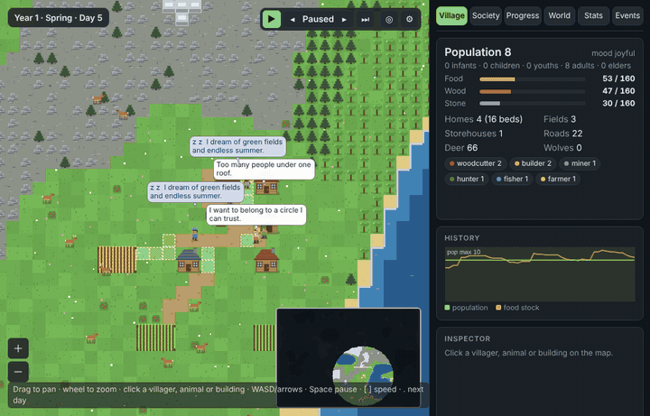
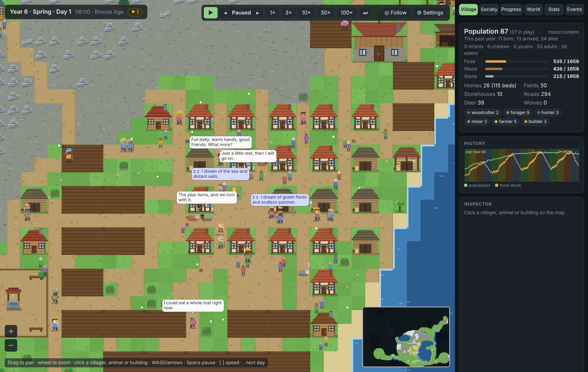
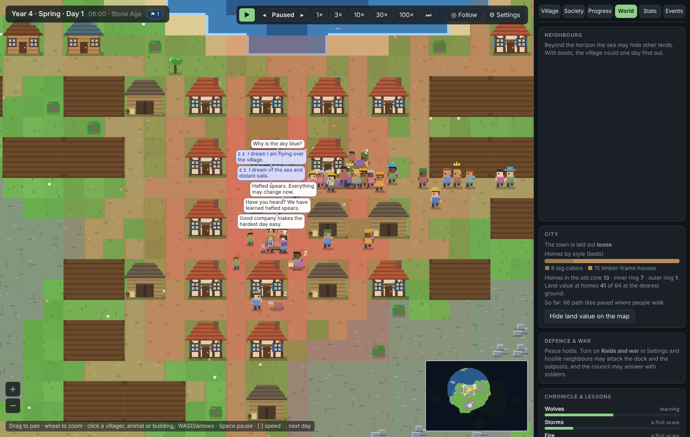
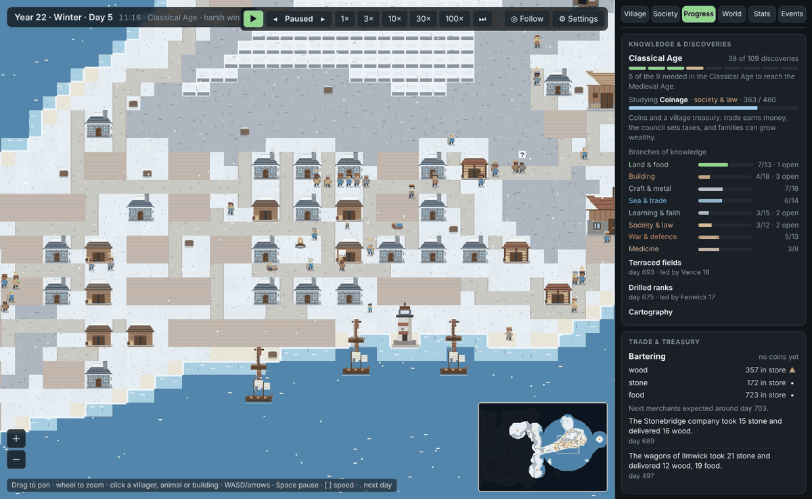
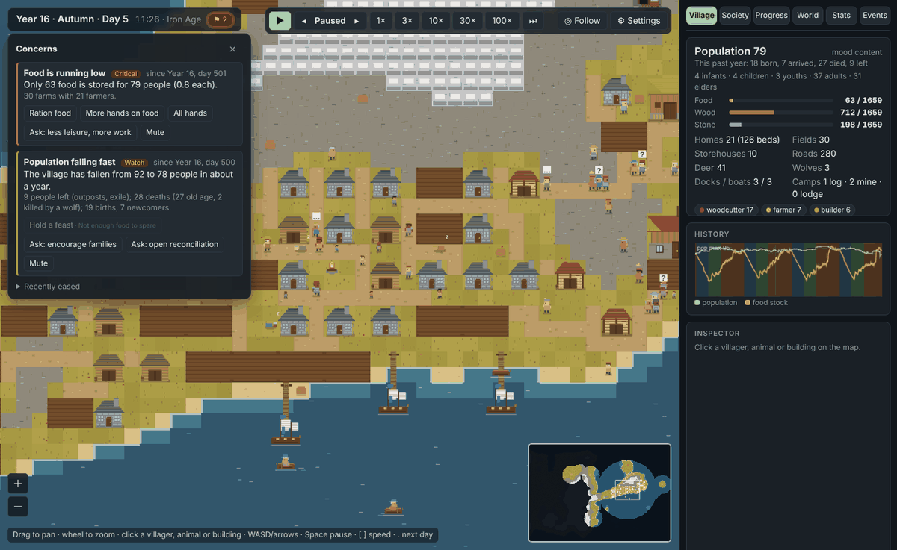
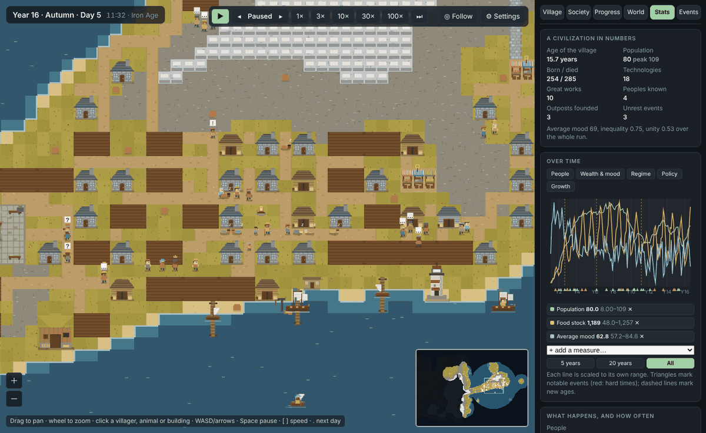
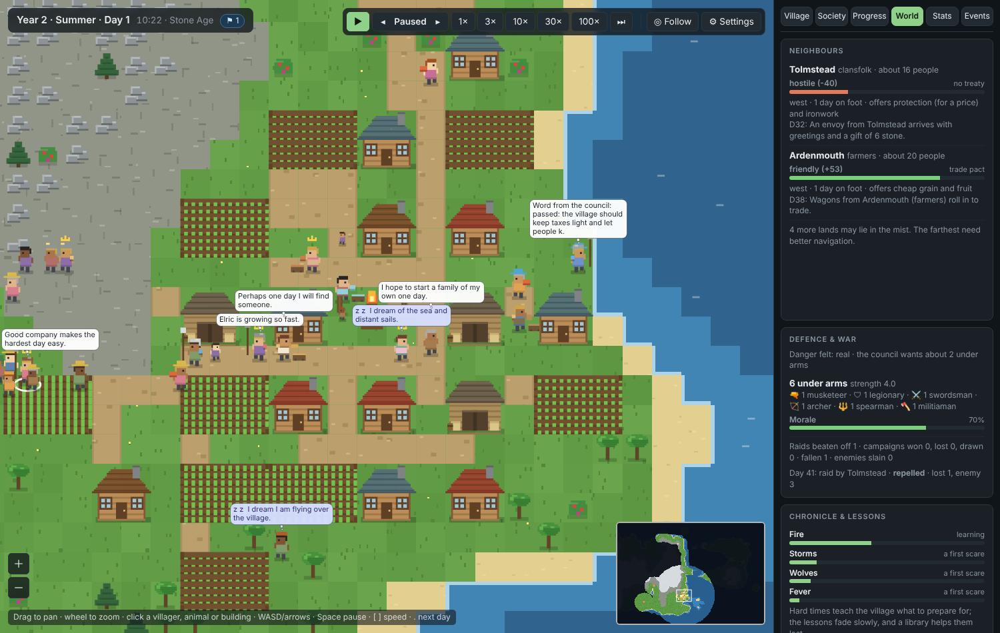
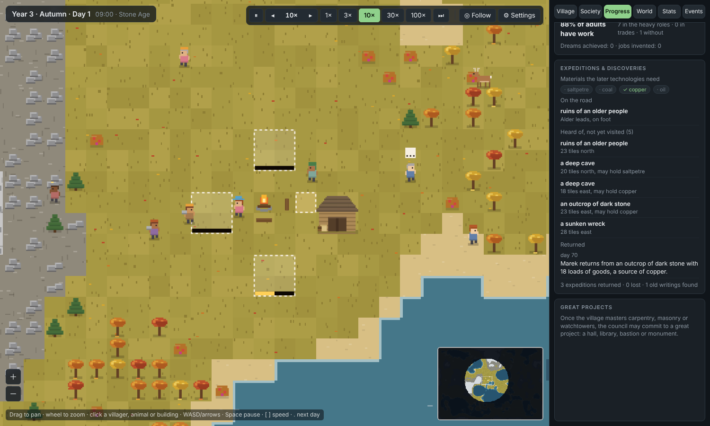

<h1 align="center">Village Sim</h1>

<b>A watch-mostly village that grows into a civilization.</b> Pixel art drawn in code · a deterministic seeded simulation · plain script tags: no build step, no dependencies v0.36 · MIT license · <a href="CHANGELOG.md">Changelog</a> · <a href="docs/FEATURES.md">All features</a> · <a href="docs/ARCHITECTURE.md">How it works</a>

Five years of one village in 44 frames. Nobody is steering: the people plan, build, trade, argue and grow.

## Play
**Open `index.html` in any browser.** No install, no build, no server, and it works straight from `file://`. Pick a seed and a map in *New world* (islands, archipelago, continent, peninsula, lakeland, river land), watch, and click anyone or anything to find out why it is doing what it is doing.

## What you get
- **A town that decides for itself.** People with personalities, opinions, hobbies and families choose jobs, marry, quarrel, vote on a council and found hamlets and outposts. Their law, rulers and customs differ from seed to seed.
- **A world with weather and seasons.** Four seasons, wildlife, floods, fever, drought, harsh winters. Rivers, lakes, islands and neighbours across the water.
- **Ages of knowledge.** 109 technologies across nine ages change what gets built, how people work and how long they live. Knowledge can be lost.
- **An economy.** About 35 trades, markets, coins, taxes, caravans, harbours and trade routes.
- **A city with a shape.** Land value, density, suburbs and desire paths; thousands of people through a crowd model (up to about 2,800 at roughly 1 ms per tick).
- **Tools to understand it.** A Concerns panel that warns you, a Stats tab with charts and export, a chronicle, an inspector for every villager, animal and building.

## What's new
**[v0.35 Play](docs/releases/v0.35.md) and [v0.35.1](docs/releases/v0.35.1.md):** the first version you can play, not only watch. A Watch / Play switch lets you take the lead: select villagers and give orders, place buildings, lay roads, paint zones, choose the research and decide what the village still plans for itself. Villagers live longer lives, a village that dies ends with a story, and there is a manual, a menu and an About card. v0.35.1 makes switching modes seamless, fixes the endless homes concern, and adds pinch to zoom.
**[v0.34 Crowds](docs/releases/v0.34.md):** a growing town no longer slows down. The 160 people with the most story stay simulated one by one; everyone else lives on as numbers by age and is drawn as small figures at the houses. **v0.34.1:** faster tests, this redesigned page, an MIT license.

## Gallery
<table>
<tr>
<td width="50%"> <b>City structure (0.33):</b> land value, density, hamlets and workshops.</td>
<td width="50%"> <b>Ages (0.24):</b> 109 technologies and the buildings they change.</td>
</tr>
<tr>
<td width="50%"> <b>Concerns (0.24.1):</b> the village warns you when people, food or unity are in trouble.</td>
<td width="50%"> <b>Statistics (0.23):</b> charts, event rates and records.</td>
</tr>
<tr>
<td width="50%"> <b>Society (0.22):</b> regimes, councils, feuds and policy that emerge from the people.</td>
<td width="50%"> <b>Worlds (0.19):</b> islands, continents, lakes and rivers.</td>
</tr>
<tr>
<td width="50%"> <b>Conflict (0.30):</b> a watch, arms that follow technology, barracks and towers.</td>
<td width="50%"> <b>Expeditions (0.28):</b> ruins, caves, wrecks and fishing grounds to find.</td>
</tr>
</table>

Every release has its own page with a screenshot of that version: see the table below.

## Controls
Drag to pan · wheel to zoom · click a villager, animal or building · WASD/arrows pan · Space pause · 1–4 speed · F follow selected · G settings drawer · minimap click to jump.

## Saving
- **Autosave** every minute to this browser, plus when you leave the page. Next visit, a prompt offers to **Resume**. **Start fresh** keeps the old save as a backup.
- **Export file / Import file** writes a .json save you can keep, share or move to another device.
- Jobs in progress are not saved: after loading, villagers simply decide again.

## Claude counsel (optional)
Off by default, and only available on the published page. When on, the council and courts hand Claude a short list of concrete options and it picks one based on each member's personality and what worked before; the choice is validated and the village's own rules decide when it is off, slow or invalid. Limited to 40 deliberations per session.

## If something goes wrong
Open the **Diagnostics** panel and use **Copy report**. It holds timings, state counts and errors with stack traces. Send that report with the world line shown in Settings (it sets the seed, map and options in one paste).

## Tests
`tools/check.sh full` runs every suite (29 suites, about 13 minutes on two cores); `tools/check.sh` alone runs only what your edit can affect; `tools/check.sh pages` runs the browser page tests. Slow suites load saved worlds from `tests/checkpoints/` (made by `tools/checkpoint.js`) instead of simulating the early game. `tools/release.sh` refuses to release code that has no green full run. More in [docs/ARCHITECTURE.md](docs/ARCHITECTURE.md).

<b>Release history</b> (every version, one page each)

| Version | Title |
|---|---|
| [v0.34](docs/releases/v0.34.md) | Crowds |
| [v0.33](docs/releases/v0.33.md) | City structure |
| [v0.32](docs/releases/v0.32.md) | Settlements, causes of death and housing |
| [v0.31](docs/releases/v0.31.md) | Society depth |
| [v0.30](docs/releases/v0.30.md) | Conflict |
| [v0.29.2](docs/releases/v0.29.2.md) | Varied bubbles and quicker tests |
| [v0.29.1](docs/releases/v0.29.1.md) | Test suite overhaul |
| [v0.29](docs/releases/v0.29.md) | Voices and thoughts |
| [v0.28.1](docs/releases/v0.28.1.md) | Scarcer materials, new discoveries and a world check |
| [v0.28](docs/releases/v0.28.md) | Expeditions, discovery and a living sea |
| [v0.27](docs/releases/v0.27.md) | Unlocks, research limits and a shaped land |
| [v0.26](docs/releases/v0.26.md) | Growth and housing |
| [v0.25](docs/releases/v0.25.md) | Livelihoods |
| [v0.24.2a](docs/releases/v0.24.2a.md) | Concern tracker |
| [v0.24.1](docs/releases/v0.24.1.md) | Concerns |
| [v0.24](docs/releases/v0.24.md) | Technology and ages |
| [v0.23](docs/releases/v0.23.md) | Statistics and insight |
| [v0.22](docs/releases/v0.22.md) | Lives and society depth |
| [v0.21](docs/releases/v0.21.md) | Settlements and expansion |
| [v0.20](docs/releases/v0.20.md) | Maritime and river commerce |
| [v0.19](docs/releases/v0.19.md) | Map types |
| [v0.18](docs/releases/v0.18.md) | Movement and population |
| [v0.17](docs/releases/v0.17.md) | A living world |
| [v0.16](docs/releases/v0.16.md) | Inspector overhaul |
| [v0.15](docs/releases/v0.15.md) | Divided villages |
| [v0.14](docs/releases/v0.14.md) | Divergent societies |
| [v0.13](docs/releases/v0.13.md) | Tabbed side panel |
| [v0.12](docs/releases/v0.12.md) | Building stats |
| [v0.11](docs/releases/v0.11.md) | Diplomacy and trade with neighbours |
| [v0.10](docs/releases/v0.10.md) | The wider sea |
| [v0.9.1](docs/releases/v0.9.1.md) | Gathering places |
| [v0.9](docs/releases/v0.9.md) | Time travel and more projects |
| [v0.8](docs/releases/v0.8.md) | Factions and history |
| [v0.7](docs/releases/v0.7.md) | Great projects |
| [v0.6](docs/releases/v0.6.md) | Trade, money and taxes |
| [v0.5](docs/releases/v0.5.md) | Technology, boats and camps |
| [v0.4](docs/releases/v0.4.md) | Saving |
| [v0.3](docs/releases/v0.3.md) | Lives, opinions and a council |
| [v0.2](docs/releases/v0.2.md) | First playable village |

## Roadmap
v0.36 **Look and sound** is the first public release: a variety audit, sound and music, scenarios, a tales-of-the-village game over, and launch preparation. Then a metropolis-scale population, resources and energy, and the late ages. See the [changelog](CHANGELOG.md).

## License
[MIT](LICENSE).
