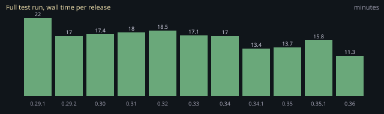

# Testing Village Sim

Village Sim is a deterministic simulation: the same seed always plays out the same way. That one property shapes everything below. A test can set a world up, run it for a number of days, and check what happened, with no mocks and no flakiness from the simulation itself.

There is **no compile step**. The game is plain script tags in `index.html`; the tests load exactly the same files, in the same order, straight from those tags (`tests/lib.js`). What you test is what ships.

## The tiers

| Tier | What it is | How long | When it runs |
|---|---|---|---|
| **Smoke** | The suites that the changed files can reach, plus a syntax check of every file. Edits that only touch browser code need none. | seconds to a few minutes | after every edit (`tools/check.sh`) |
| **Black box** | Browser page tests (Playwright): load `index.html`, click, tap, drag and type like a player, and check what is on the screen. 15 pages, including touch, pinch zoom, the Play bar and sound. | about 4 minutes | every x.y release (`tools/check.sh pages`) |
| **White box** | Node suites that load the simulation in a sandbox and check its inner state: births, deaths, orders, wars, trade, saves. 32 suites. Many start from a stored checkpoint world so they do not replay the first years. | about 11 minutes on two cores | every release that touches the simulation (`tools/check.sh full`) |
| **Comprehensive** | The full run, plus a **golden trajectory** (30 days on each of six map types compared with a stored result), a **speed gate** (the sim must stay under 1.5 ms a tick; it measures about 1.0), save and load round trips, and long 30 to 40 year runs on several seeds and maps with the coverage audit below. | an hour or more, in the background | every x.y release |

A release cannot be built unless the exact code has a green full run (`tools/release.sh` checks a hash of the files). A failing build is never released.

## What we test

- **Rules of the village:** growth, housing, food, work, council decisions, research, trade, war, culture, strife, game over.
- **Play controls:** orders, building, roads, zones, the Watch/Play switch, touch placing with confirm and undo.
- **Saves:** every save loads, old saves migrate, a reloaded world carries on.
- **Determinism:** the golden trajectory changes only when we mean it to; a change in it is reviewed before it is accepted.
- **Speed:** a perf gate, plus a check that thought bubbles and voices leave the simulation itself unchanged.
- **The screen:** key panels render, nothing throws, the toolbar fits a phone.

## What we do not test

- **Taste.** Whether the village feels alive, whether the music is pleasant, whether a screen is clear: these are looked at by a person. The coverage audit gives numbers (how often things happen, what is never seen) but cannot say what is fun.
- **Every browser.** The page tests run in Chromium. Safari, Firefox and phones are tried by hand.
- **Real audio output.** We check that sound starts, schedules and survives every mood and event; how it sounds is judged by ear.
- **Network.** The game works offline. The optional ratings server is tested on its own when it exists.

## Timings



The table behind this chart, with elapsed development time, number of full runs and failed runs per release, is in [dev-stats.md](dev-stats.md). Each test run also appends a line to `tests/runlog.jsonl`, and `tools/devstats.js` turns them into the table.

## Coverage audit (variety and experience)

`tools/coverage.js` plays whole worlds for years on several seeds, map types and Hardship levels and reports, from the events the game already counts:

- how often each kind of event happens, and in which year it first appears;
- the share of days each concern is on (anything above about 40 per cent is flagged: one worry that is always on gets tiresome);
- which features were never seen (bridges, expeditions, raids, dreams, trade kinds, and so on);
- what limits growth, as the share of birth attempts stopped by each gate, by stretch of years;
- population by year for Gentle, Normal and Harsh.

Run it with `node tools/coverage.js run SEED MAP YEARS HARDSHIP` for each world, then `node tools/coverage.js report`. The latest report is in [coverage.md](coverage.md).

## How to run

```
tools/check.sh                 # only what the changes can affect
tools/check.sh full            # every node suite, two at a time
tools/check.sh pages           # browser page tests
tools/check.sh name name       # named suites
node tests/golden.js --update  # accept a changed trajectory (after review)
```

## Testing roadmap

- **Impact analysis from real coverage:** record which functions each suite runs (V8 coverage) and rebuild the "which suites does this change affect" map from it, so a small change runs only the suites that exercise it.
- **More checkpoint worlds** so the slowest suites start from year 4 instead of year 0 (v0.36 moved stats_events and bld; next in line: discovery_events, war_events, outposts).
- **Fast first-look probes** that start from year-10 and year-14 checkpoints, with the full 30-year calibration batch (`tools/covbatch.sh`) run only when the population model or Hardship changes.
- **Cross-browser page tests** (Firefox and WebKit) once the game is public.
- **A "good player" script** that plays Harsh with Play orders, as the reference for the difficulty levels.
- **Soak tests** that run overnight on a spread of seeds and report faults and growth limits.
