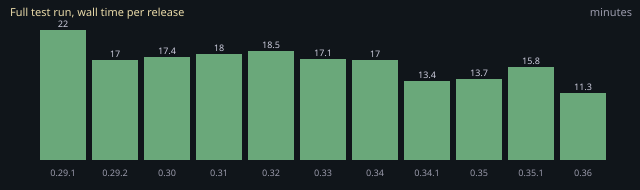

# Development statistics

Generated by `tools/devstats.js` from `docs/dev-stats.csv` (older rows were backfilled from the release notes; elapsed time is measured from v0.36 on). Every test run also adds a line to `tests/runlog.jsonl`.

| Release | Date | Elapsed (min) | Full run (min) | Suites | Test time (min) | Full runs | Page runs | Failed runs | Source lines | Source KB |
|---|---|---|---|---|---|---|---|---|---|---|
| v0.29.1 | 2026-11-08 |  | 22 | 24 |  |  |  |  |  |  |
| v0.29.2 | 2026-11-08 |  | 17 | 24 |  |  |  |  |  |  |
| v0.30 | 2026-11-10 |  | 17.4 | 25 |  |  |  |  |  |  |
| v0.31 | 2026-11-12 |  | 18 | 26 |  |  |  |  |  |  |
| v0.32 | 2026-11-15 |  | 18.5 | 27 |  |  |  |  |  |  |
| v0.33 | 2026-11-20 |  | 17.1 | 28 |  |  |  |  |  |  |
| v0.34 | 2026-11-22 |  | 17 | 29 |  |  |  |  |  |  |
| v0.34.1 | 2026-11-24 |  | 13.4 | 29 |  |  |  |  |  |  |
| v0.35 | 2026-11-24 |  | 13.7 | 31 |  |  |  |  |  |  |
| v0.35.1 | 2026-11-24 |  | 15.8 | 31 |  | 2 | 2 | 3 |  |  |
| v0.36 | 2026-11-25 | 387 | 11.3 | 32 | 40.9 | 2 | 2 | 2 | 9594 | 945 |
