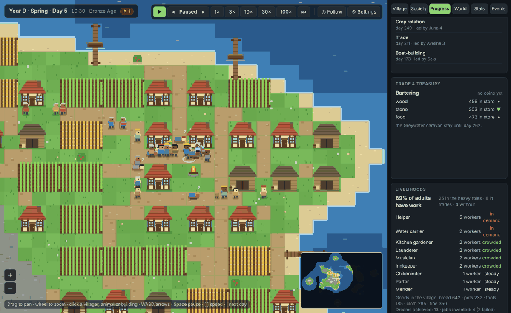

About 35 trades (odd jobs, crafts and services) with real demand, goods and prices; side jobs, villager-invented jobs that catch on or fail, overtime by regime, aspirations, and craftspeople with aprons, tools and workbenches.

