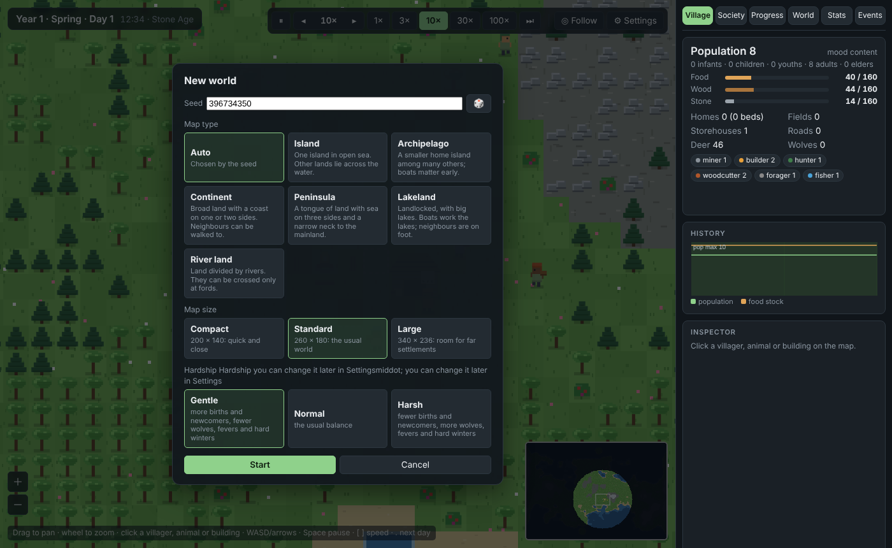

Births, pairing and newcomers now follow prosperity; a Hardship setting (Gentle, Normal, Harsh) at creation and live; builders plan ahead; health technology lengthens life; privacy and personal space (private houses, cabins, crowding, outdoor sleeping); a Housing concern with a Building drive; old saves keep their statistics. Six island seeds, 12 years: mean population 90 to 141 at year 12.

