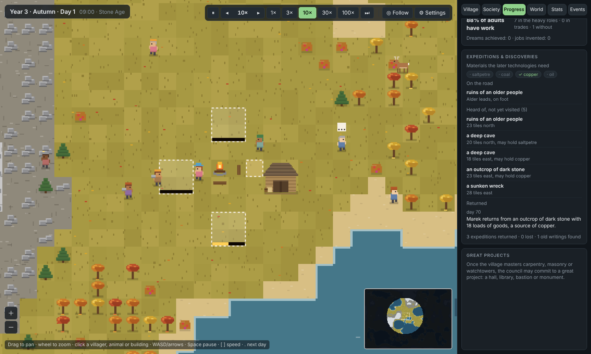

Every map hides about 23 places worth a journey: ruins of an older people, deep caves, outcrops of dark stone, buried hoards, sunken wrecks, rich fishing grounds and whaling grounds, plus the village's own past (a trading ship it lost, an outpost that died out). Rumours reveal them one by one and the council weighs an expedition like any other project. A leader (with a few escorts on land, or a provisioned boat at sea) brings home goods, old writings (even a technology the village had forgotten), food, or a source of saltpetre, coal, copper or oil: new material gates for gunpowder, steam, steel, electricity, engines and aviation.

Also: fish recover faster where the water is full, deer winter in sheltered pockets and return in spring, river barges carry bulk goods to neighbours reached by water, friendly neighbours sell lessons for coins, discovery messages say what a technology opens, new statistics series (works built, tiles won, sites, finds, materials, fish, deer) and an Expeditions & discoveries card with map flags for known sites.

