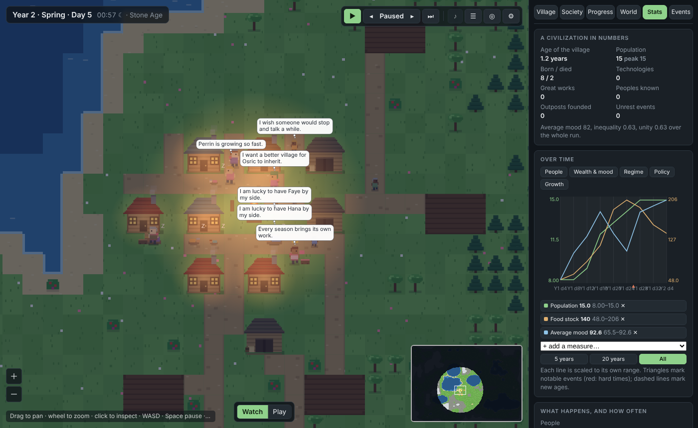

# v0.38.1 — Fixes and polish

Fixes and polish after v0.38 (Pace), with no change to the simulation: saves, seeds and growth behave exactly as in v0.38.

- **Diagnostics** fills the moment you open it and refreshes every second, and shows a message if the snapshot cannot be built.
- **Stats graph:** day marks in the first two years, value range of the first two lines at the edges.
- **Land value:** stronger overlay and a legend line in the City card.
- **World tab:** the Neighbours card sizes to its content and sits last until you meet someone.
- **Resource notices:** one steady notice line under the food, wood and stone bars instead of notes that came and went.
- **Copyright:** © 2026 Zaat, MIT license, in About, the README and the source files.

Play it: https://zaat.github.io/village-sim/
