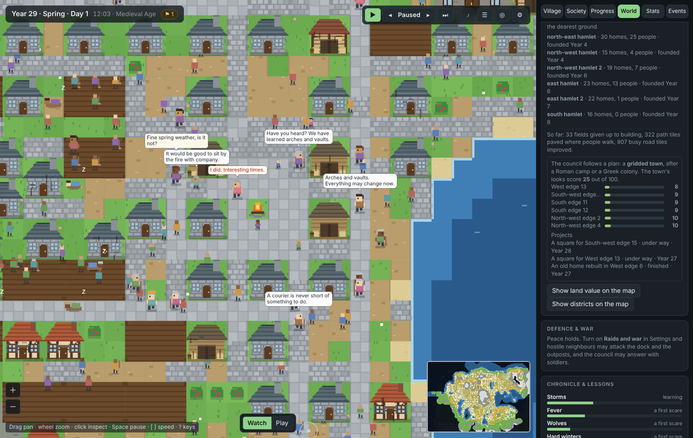

# v0.40 — Farming, energy, reach and City design

- **Finite deposits and an energy ladder**: stone, coal, oil and peat run out; winter heat moves from wood to peat or coal to power stations; shortages slow work a little and raise a concern; boats fetch stone from far shores.
- **Farming ladder**: the food card explains what each technology adds to a harvest and names the next step.
- **Explorers and reach (#180)**: expeditions to other islands, a sky survey, a pennant on explorers.
- **Steadier speed (#134, #135)**: the day's heavy jobs run at six moments instead of one, and 100x frames stay shorter.
- **City design, first version**: a commissioned layout style, a beauty score per district and a project ledger of squares, remodels and heritage homes.
- **Fixes**: saves that could not be loaded, zip export, the crowd at 100x, narrow windows, Check this world, the workshop panel (#181), Years in the Events tab, the causes-of-death card.
- Moved to later releases: culture rebuilt (#140), age look beyond palettes (#141), transport planning (#143), ranks and ambitions (#145), forest regrowth (#4), wildlife (#10), more deposits (#184), player approval of design projects (#182), a city that keeps changing (#183).

Play it: https://zaat.github.io/village-sim/
